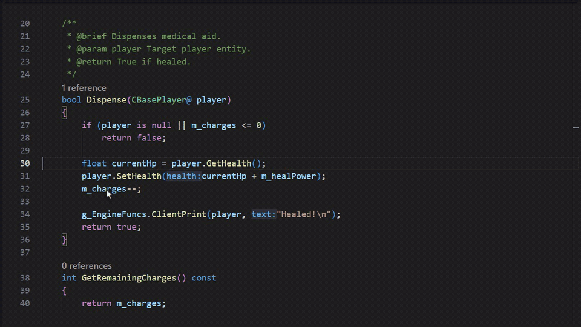
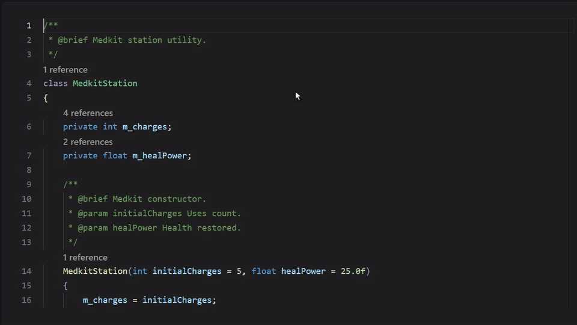

# Angelscript for VS Code

**[English](README.md)** | **[Español](docs/README.es.md)**

[](https://marketplace.visualstudio.com/items?itemName=Gaftherman.angelscript-gaftherman)
[](https://marketplace.visualstudio.com/items?itemName=Gaftherman.angelscript-gaftherman)
[](https://opensource.org/licenses/MIT)
[](https://hub.xerj.org/contributors/Gaftherman)

Angelscript gives VS Code a native C++20 language server for AngelScript (`.as`). It uses Tree-Sitter to parse scripts and index their symbols. It analyzes the workspace from syntax trees without running the game engine or concatenating scripts.

Use it with Sven Co-op, other game engines, or your own `CScriptBuilder` setup. You get hover, completion, navigation, flow-sensitive null checks, and type inference across the workspace.

<p align="center"><br><em>Hover over a call to see its signature and doc comment.</em></p>

## Installation

Install from the [Visual Studio Code Marketplace](https://marketplace.visualstudio.com/items?itemName=Gaftherman.angelscript-gaftherman) or search for **Angelscript** by Gaftherman in Extensions (`Ctrl+Shift+X`). You can also press `Ctrl+P`, paste `ext install Gaftherman.angelscript-gaftherman`, and press Enter.

To install a VSIX, press `Ctrl+Shift+P`, run **Extensions: Install from VSIX...**, and select `angelscript-*.vsix`.

1. Open a folder with `.as` files.
2. If your game supplies its own types or functions, you can add an `.as.predefined` stub.
3. If your project needs custom checks or shared engine settings, you can add an `angelscript.rules.json` file.

## Features

<div align="center">

| Feature | Status |
| :--- | :--- |
| Completion | ✅ |
| Hover | ✅ |
| Signature help | ✅ |
| Definition, declaration, and type definition | ✅ |
| References | ✅ |
| Rename | ✅ |
| Document and workspace symbols | ✅ |
| Semantic tokens | ✅ |
| Inlay hints | ✅ |
| Code actions | ✅ |
| Document and range formatting | ✅ |
| Push and pull diagnostics | ✅ |

</div>

<table>
<tr><td><strong>Hover</strong><br>See a symbol's signature and documentation.<br></td>
<td><strong>Autocomplete</strong><br>Type after a dot to see matching members.<br></td></tr>
<tr><td><strong>Signature help</strong><br>See which parameter you are filling in as you type a call.<br></td>
<td><strong>Diagnostics</strong><br>See warnings such as unused variables in the editor.<br></td></tr>
<tr><td><strong>Go to Definition</strong><br>Jump from a name to its definition.<br></td>
<td><strong>Find All References</strong><br>List the places where a symbol is used.<br></td></tr>
<tr><td><strong>Rename</strong><br>Change a script symbol's name and update its uses.<br></td>
<td><strong>Code actions</strong><br>Open the lightbulb to see fixes and refactorings.<br></td></tr>
<tr><td><strong>Formatting</strong><br>Format the whole script or just the selected lines.<br></td>
<td><strong>Inlay hints</strong><br>See parameter names beside call arguments.<br></td></tr>
<tr><td><strong>Code lens</strong><br>See the reference count above a declaration.<br></td>
<td><strong>Outline</strong><br>Browse the current script's classes, functions, and other symbols.<br></td></tr>
<tr><td><strong>Semantic highlighting</strong><br>See parameters and fields colored by what they represent.<br></td>
<td><strong>Host API</strong><br>Get completion for the types and functions declared in your stub.<br></td></tr>
<tr><td><strong>Engine rules</strong><br>See your team's custom checks in the editor.<br></td>
<td><strong>Engine options</strong><br>Match the checks to the language options your host uses.<br></td></tr>
</table>

## Host API stubs (.as.predefined)

In AngelScript, the host application registers its C++ API so your scripts can call its functions and use its types. AngelLSP loads `.as.predefined` stubs that describe those declarations for completion, hover, and diagnostics.

| Host | Stub | Notes |
| :--- | :--- | :--- |
| Sven Co-op | [Sven Co-op - Gaftherman](https://github.com/Gaftherman/angelscript-lsp/blob/main/predefined/sven.as.predefined) | **Recommended**. Actively maintained for Sven Co-op 5.26+ API bindings, with const-correct declarations, ref qualifiers, and math and engine structs. |
| Sven Co-op | [Sven Co-op - Sashi0034](https://github.com/sashi0034/angel-lsp/blob/main/examples/Sven%20Co-op/as.predefined) | **Legacy**. Kept for older projects. Its bindings are outdated for current engine releases. |
| Trackmania Nations Forever | [Trackmania Nations Forever - Sashi0034](https://github.com/sashi0034/angel-lsp/blob/main/examples/Trackmania%20Nations%20Forever/as.predefined) | Compatible. Includes bindings for `CGameCtnApp` and `MwFastBuffer`. |
| OpenSiv3D | [OpenSiv3D - Sashi0034](https://github.com/sashi0034/angel-lsp/blob/main/examples/OpenSiv3D/as.predefined) | Compatible. Includes bindings for `Vec2`, `ColorF`, and `Circle`. |

In `.vscode/settings.json`, set `"angelscript.predefined.active": "${workspaceFolder}/path/to/stub.as.predefined"` or use `"all"` to load every discovered stub. The default is `""`, which selects the first stub in path order. You can also run **AngelScript: Select Predefined Stub** or open the **AngelScript IntelliSense** status item to choose one.

<p align="center"></p>

<p align="center"></p>

## Engine rules

Put an `angelscript.rules.json` file in your workspace root to share engine settings and custom checks. For example, you can warn when a type is stored in a class field.

<p align="center"></p>

<p align="center"></p>

## Engine options

Use `angelscript.engine.*` in VS Code to match your host's language options. For example, set `angelscript.engine.foreachSupport` to `false` if your host disables `foreach`.

<p align="center"></p>

## Debugger

The VS Code debugger connects to your game or host so you can debug scripts while they run. Start a host with [asdebugger](https://github.com/Gaftherman/asdebugger) listening on `127.0.0.1:9002`. Save this as `.vscode/launch.json` and select it in **Run and Debug**.

```json
{
  "version": "0.2.0",
  "configurations": [
    {
      "name": "Attach to Game",
      "type": "angelscript",
      "request": "attach",
      "port": 9002,
      "protocol": "dap"
    }
  ]
}
```

See the [debugger example project](https://github.com/Gaftherman/angelscript-debugger-example) for a host setup.

## Documentation

- [Detailed Guide](docs/GUIDE.md) — workspace examples, predefined files, engine options, and commands.
- [Configuration Guide](docs/CONFIGURATION.md) — settings and editor examples.
- [Engine Rules Guide](docs/RULES.md) — how to write `*.angelscript.rules.json` files.
- [CHANGELOG.md](CHANGELOG.md) — release history and changes.

## Building from source

```bash
cmake -B server/build -S server -DCMAKE_BUILD_TYPE=Release
cmake --build server/build --config Release
ctest --test-dir server/build -C Release --output-on-failure
cd client && npm install && npm run compile && npm run bundle
```

Licensed under the [MIT License](LICENSE).
