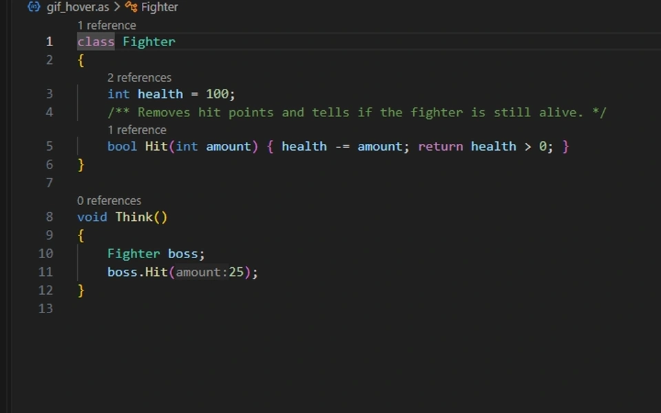
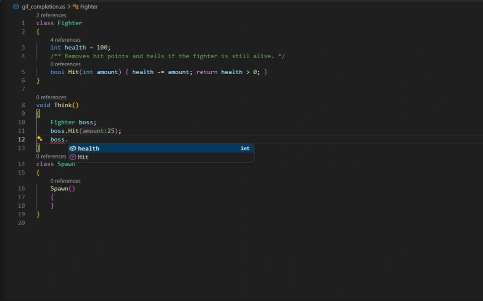
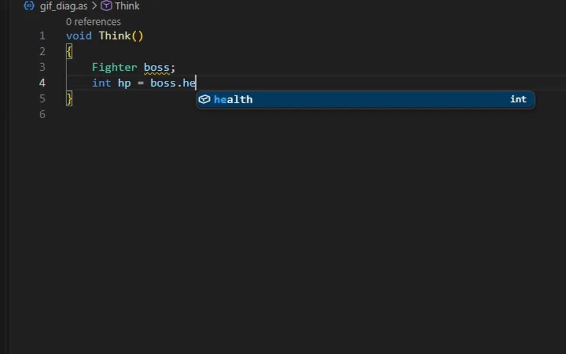
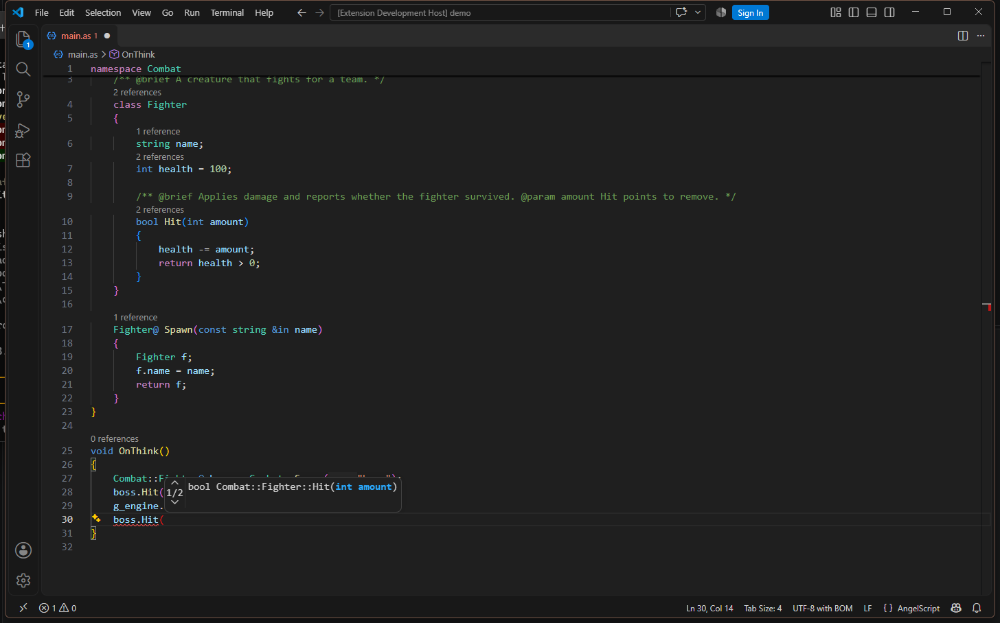
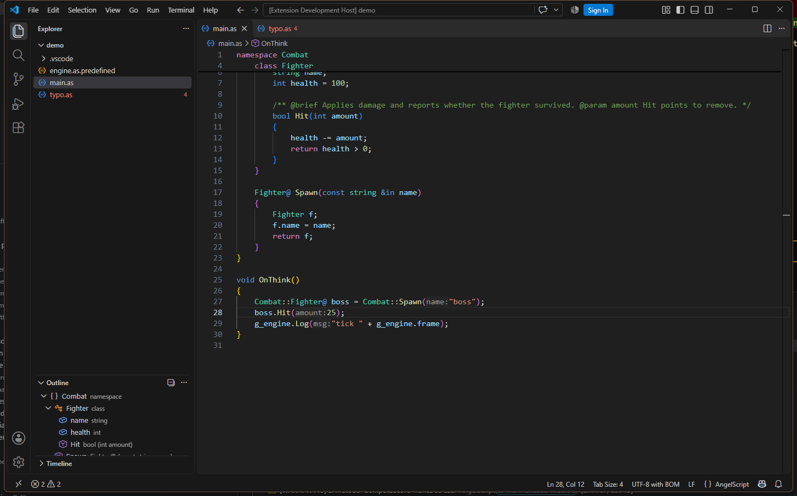
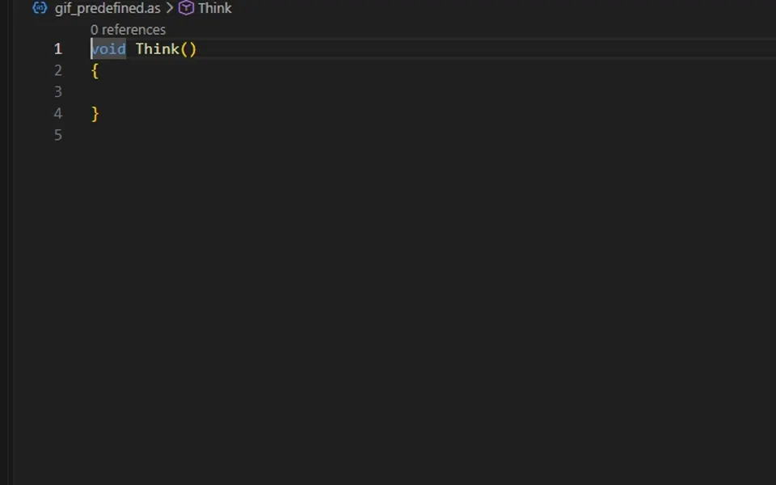
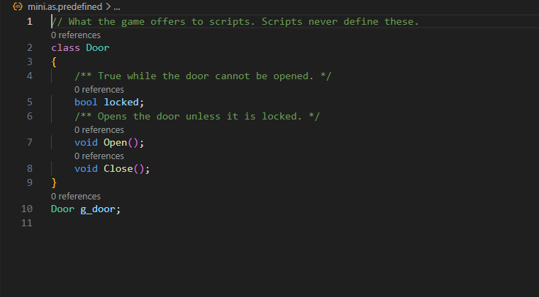
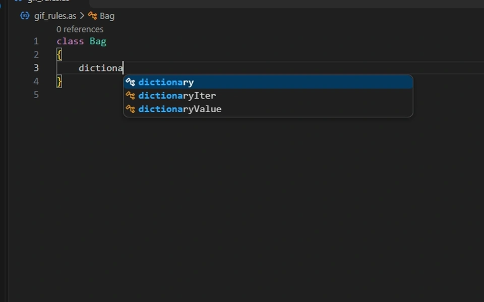
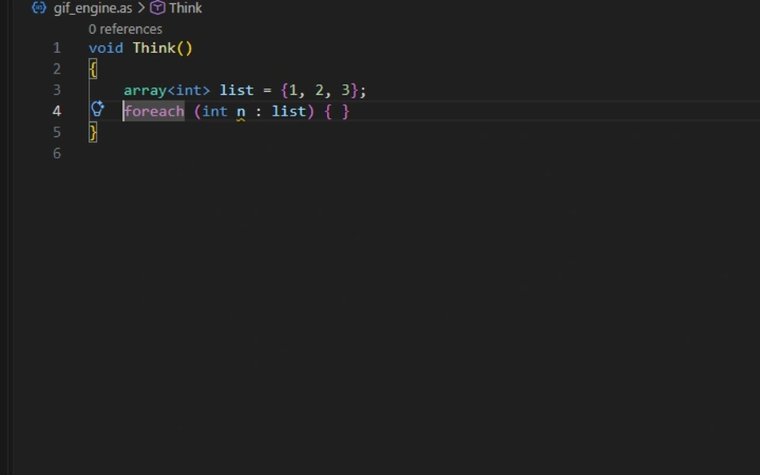

# Angelscript para VS Code

**[English](README.md)** | **[Español](README.es.md)**

[](https://marketplace.visualstudio.com/items?itemName=Gaftherman.angelscript-gaftherman)
[](https://marketplace.visualstudio.com/items?itemName=Gaftherman.angelscript-gaftherman)
[](https://opensource.org/licenses/MIT)
[XERJ Corpus Hub contributor](https://hub.xerj.org/contributors/Gaftherman)

Angelscript agrega autocompletado, documentación al pasar el cursor, detección de errores y navegación de código para archivos AngelScript (`.as`) en VS Code.

<p align="center"><br><em>Deja el cursor sobre una función o método para ver su firma y su comentario de documentación.</em></p>

## Primeros pasos

1. Instala esta extensión desde [Visual Studio Code Marketplace](https://marketplace.visualstudio.com/items?itemName=Gaftherman.angelscript-gaftherman) o desde la vista de Extensiones de VS Code.
2. Abre una carpeta que contenga archivos de script `.as`.
3. Opcional: agrega un archivo `.as.predefined` a tu carpeta si tu juego ofrece tipos o funciones propias.

## Qué obtienes

| Función | Qué ves | Imagen |
| :--- | :--- | :--- |
| Hover | Observa cómo aparece la firma y la documentación al dejar el cursor sobre un símbolo. |  |
| Autocompletado | Observa cómo aparecen los métodos y campos disponibles al escribir después de `.` o `::`. |  |
| Diagnósticos | Observa los subrayados rojos y amarillos en errores de escritura y variables sin usar mientras escribes. |  |
| Ayuda de firma | Los nombres y tipos de parámetros siguen visibles mientras completas una llamada. |  |
| Esquema | El panel Esquema muestra cada espacio de nombres, clase, campo y método del archivo. |  |

## Indica qué ofrece tu juego

Tu motor expone clases, funciones y variables globales que no están escritas dentro de tus scripts `.as`. Puedes declararlas en un archivo `.as.predefined`, que es un archivo que lista lo que el juego ofrece a los scripts (conocido como stub). Con ese archivo en `${workspaceFolder}`, el autocompletado y el hover reconocen la API del juego sin falsos errores.

<p align="center"><br><em>Observa cómo el editor reconoce los tipos y métodos del juego en cuanto se carga el archivo `.as.predefined`.</em></p>

<p align="center"></p>

## Agrega tus propias reglas

Un archivo `*.angelscript.rules.json` permite a tu equipo fijar opciones del motor y añadir sus propios avisos. Por ejemplo, avisar cuando un tipo se guarda en un campo de clase. Pon el archivo en `${workspaceFolder}` y el editor lo carga solo.

<p align="center"><br><em>Observa cómo una regla personalizada marca un campo no permitido dentro del editor.</em></p>

<p align="center"></p>

## Ajusta el comportamiento a tu motor

Cada juego configura AngelScript con sus propias reglas de sintaxis, como permitir bucles `foreach` o cadenas en varias líneas. Puedes igualar esa configuración desde los ajustes `angelscript.engine.*` en VS Code. Al cambiar una opción, las comprobaciones del editor se actualizan de inmediato.

<p align="center"><br><em>Observa cómo aparece o desaparece un error al cambiar una opción del motor en la configuración.</em></p>

## Documentación

- [Guía detallada](https://github.com/Gaftherman/angelscript-lsp/blob/main/docs/guide.es.md) — ejemplos de espacio de trabajo, archivos predefinidos, opciones del motor, comandos y catálogo completo de ajustes.
- [Guía de reglas del motor](https://github.com/Gaftherman/angelscript-lsp/blob/main/docs/rules.es.md) — cómo escribir archivos `*.angelscript.rules.json`.
- [CHANGELOG.md](CHANGELOG.md) — historial de versiones y cambios.

## Compilar desde el código fuente

```bash
cmake -B server/build -S server -DCMAKE_BUILD_TYPE=Release
cmake --build server/build --config Release
ctest --test-dir server/build -C Release --output-on-failure
cd client && npm install && npm run compile
```

Bajo licencia [MIT](LICENSE).
