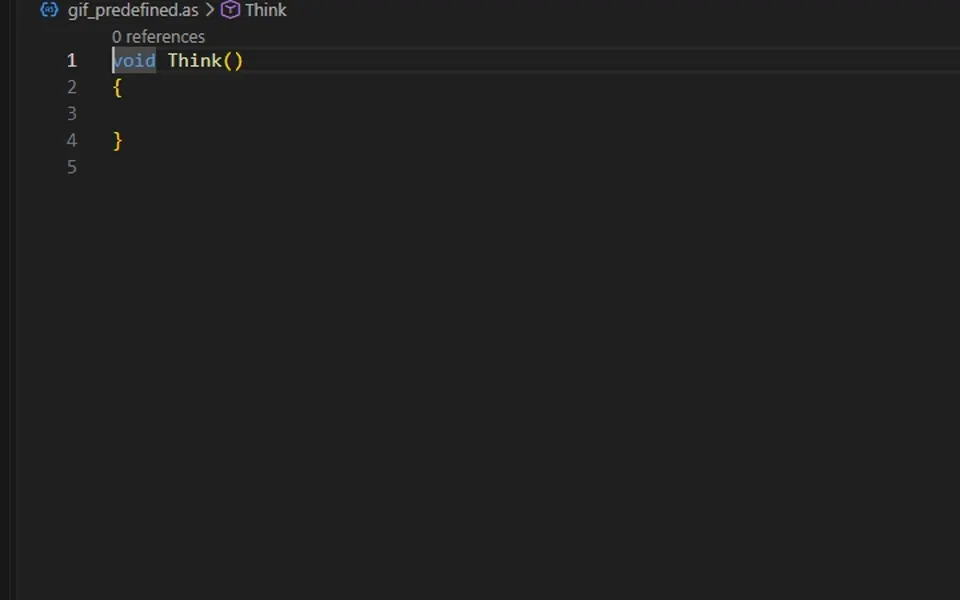
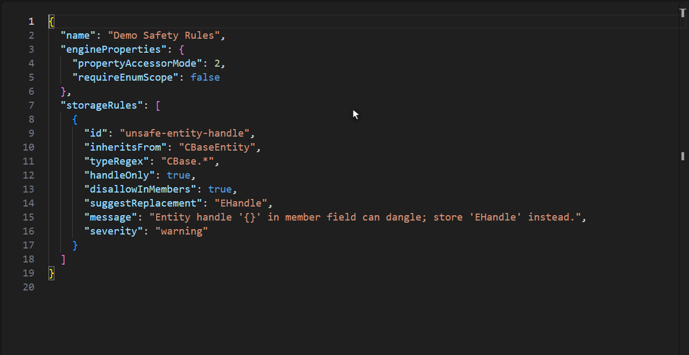
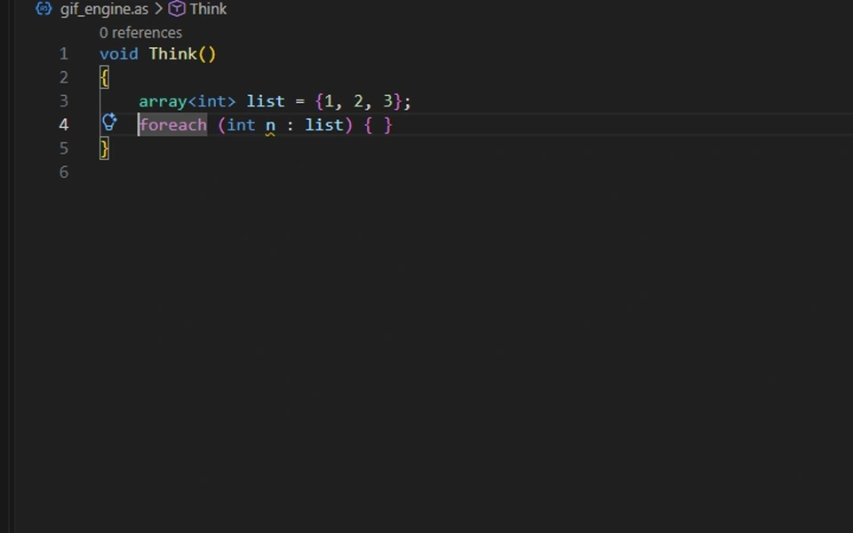

# Angelscript for VS Code

**[English](README.md)** | **[Español](README.es.md)**

[](https://marketplace.visualstudio.com/items?itemName=Gaftherman.angelscript-gaftherman)
[](https://marketplace.visualstudio.com/items?itemName=Gaftherman.angelscript-gaftherman)
[](https://opensource.org/licenses/MIT)
[XERJ Corpus Hub contributor](https://hub.xerj.org/contributors/Gaftherman)

Angelscript adds autocomplete, hover documentation, error checks, and code navigation for AngelScript (`.as`) files in VS Code.

<p align="center"><br><em>Rest the cursor on a function or method call to see its signature and doc comment.</em></p>

## Get started

1. Install this extension from the [Visual Studio Code Marketplace](https://marketplace.visualstudio.com/items?itemName=Gaftherman.angelscript-gaftherman) or the Extensions view in VS Code.
2. Open a folder that contains `.as` script files.
3. Optional: add an `.as.predefined` file to your folder if your game provides built-in types or functions.

## What you get

| Feature | What you see | Image |
| :--- | :--- | :--- |
| Hover | Watch the signature and doc comment pop up when the cursor rests on a symbol. |  |
| Autocomplete | Watch matching methods and fields appear as you type after `.` or `::`. |  |
| Diagnostics | Watch red and yellow squiggles appear on typos and unused variables as you type. |  |
| Signature help | Parameter names and types stay visible while you fill in a function call. |  |
| Outline | The Outline panel lists every namespace, class, field, and method in the file. |  |

## Tell it what your game offers

Your engine adds built-in classes, functions, and globals that are not defined in your `.as` scripts. You can list them in an `.as.predefined` file, which is a file that lists what the game gives to scripts (often called a stub). With that file in `${workspaceFolder}`, autocomplete and hover recognize your game's API without false errors.

<p align="center"><br><em>Watch the editor recognize game types and methods as soon as the `.as.predefined` file is loaded.</em></p>

<p align="center"></p>

## Add your own rules

A `*.angelscript.rules.json` file lets your team set engine options and add its own checks. For example, you can warn when a type is stored in a class field. Put the file in `${workspaceFolder}` and the editor loads it by itself.

<p align="center"><br><em>Watch a custom rule flag a disallowed field type right inside the editor.</em></p>

<p align="center"></p>

## Match your engine

Each game configures AngelScript with its own language rules, such as whether `foreach` loops or multi-line strings are valid. You can match your game's setup with the `angelscript.engine.*` settings in VS Code. Changing an option updates the editor checks right away.

<p align="center"><br><em>Watch an error appear or clear as an engine option changes in settings.</em></p>

## Documentation

- [Detailed Guide](https://github.com/Gaftherman/angelscript-lsp/blob/main/docs/guide.md) — workspace examples, predefined files, engine options, commands, and full settings catalog.
- [Engine Rules Guide](https://github.com/Gaftherman/angelscript-lsp/blob/main/docs/rules.md) — how to write `*.angelscript.rules.json` files.
- [CHANGELOG.md](CHANGELOG.md) — release history and changes.

## Building from source

```bash
cmake -B server/build -S server -DCMAKE_BUILD_TYPE=Release
cmake --build server/build --config Release
ctest --test-dir server/build -C Release --output-on-failure
cd client && npm install && npm run compile
```

Licensed under the [MIT License](LICENSE).
