# Angelscript for VS Code

**[English](README.md)** | **[Español](README.es.md)**

[](https://marketplace.visualstudio.com/items?itemName=Gaftherman.angelscript-gaftherman)
[](https://marketplace.visualstudio.com/items?itemName=Gaftherman.angelscript-gaftherman)
[](https://opensource.org/licenses/MIT)
[](https://hub.xerj.org/contributors/Gaftherman)

Angelscript adds support for `.as` files to VS Code.

AngelScript is a scripting language that game engines such as Sven Co-op use to run plugin and mod code, and the extension shows documentation on hover, suggests completions, and flags errors as you edit.

The C++20 language server uses Tree-Sitter to parse scripts and index their symbols.

<p align="center">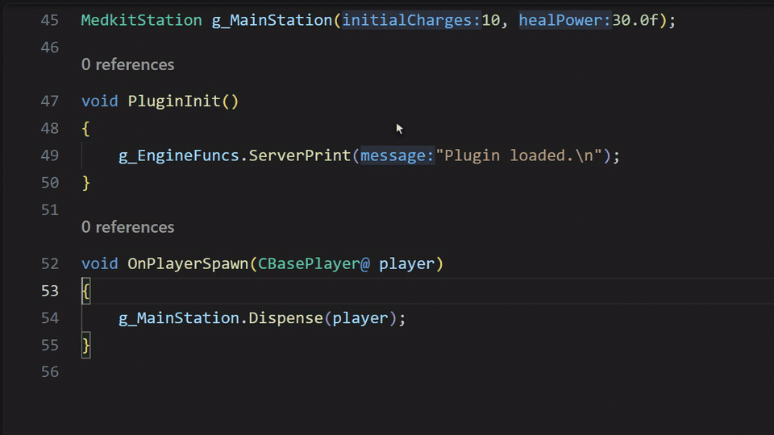</p>
<p align="center"><em>Hover over a method call to see its documentation.</em></p>

## Installation

Install from the [Visual Studio Code Marketplace](https://marketplace.visualstudio.com/items?itemName=Gaftherman.angelscript-gaftherman) or search for **Angelscript** by Gaftherman in Extensions (`Ctrl+Shift+X`). You can also press `Ctrl+P`, paste `ext install Gaftherman.angelscript-gaftherman`, and press Enter.

To install a VSIX, press `Ctrl+Shift+P`, run **Extensions: Install from VSIX...**, and select `angelscript-*.vsix`.

### Try it in 30 seconds

Open a folder in VS Code, create `hello.as`, and paste the code below. The extension checks your code as you edit, shows documentation on hover, suggests completions, and underlines errors.

```angelscript
class Calculator {
    /// Doubles a number.
    int twice(int number) { return number * 2; }
}
void Run() {
    Calculator calc;
    calc.twice(21);
}
```

Hover over `twice` in `calc.twice(21)` to see its signature and doc comment. Type `calc.` to see member suggestions. Change the original call to `calc.twcie(21)` to see the editor underline the error.

The extension does not run scripts. AngelScript scripts run inside a host application such as a game. See [Debugger](#debugger) to run and debug scripts in a host.

## Features

### Hover

See a symbol's signature and documentation.

<p align="center"></p>

### Autocomplete

Type after a dot to see matching members.

<p align="center">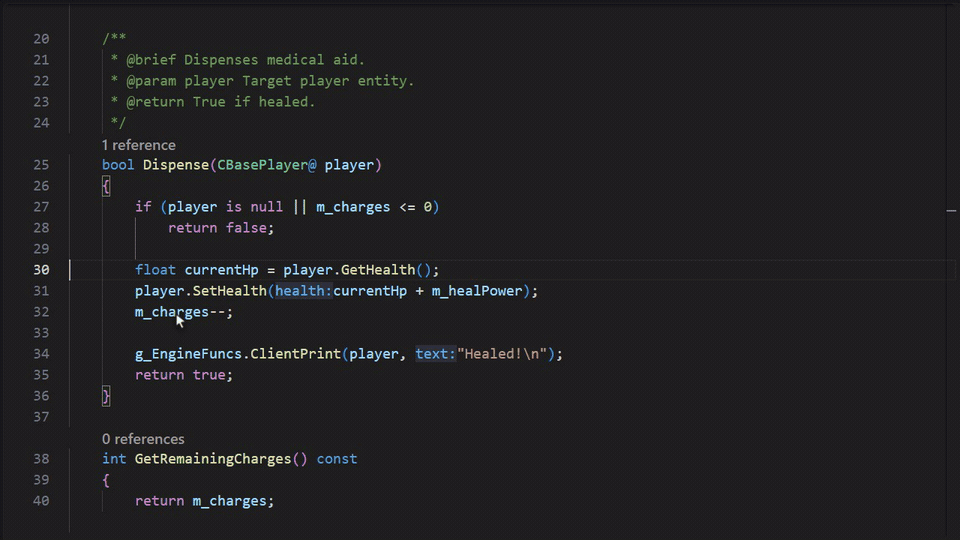</p>

### Signature help

See which parameter you are filling in as you type a call.

<p align="center">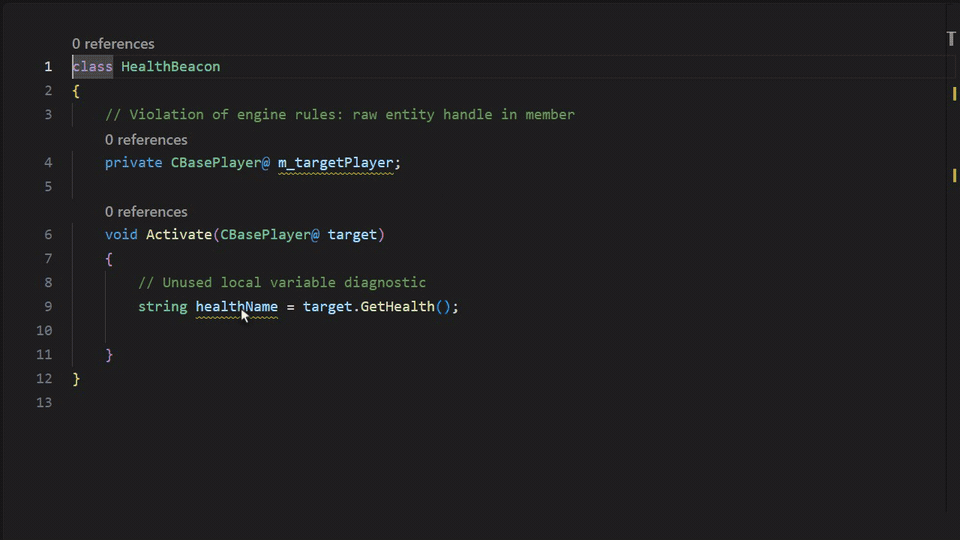</p>

### Diagnostics

See warnings such as unused variables in the editor.

<p align="center">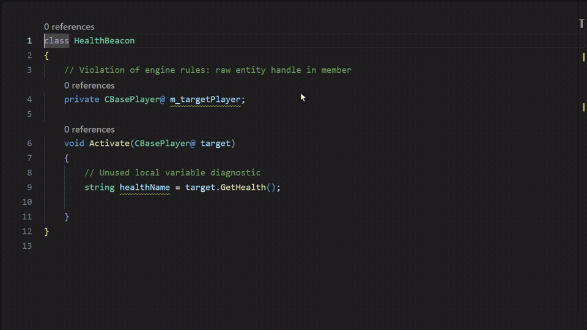</p>

### Go to Definition

Jump from a name to its definition.

<p align="center">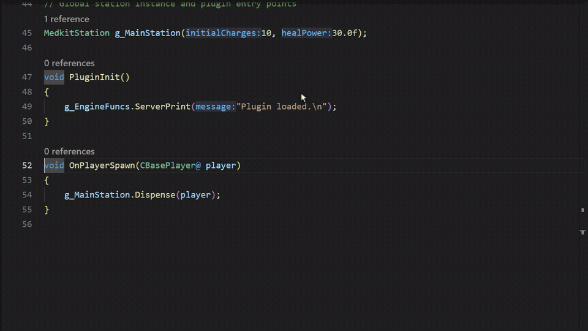</p>

### Find All References

List the places where a symbol is used.

<p align="center">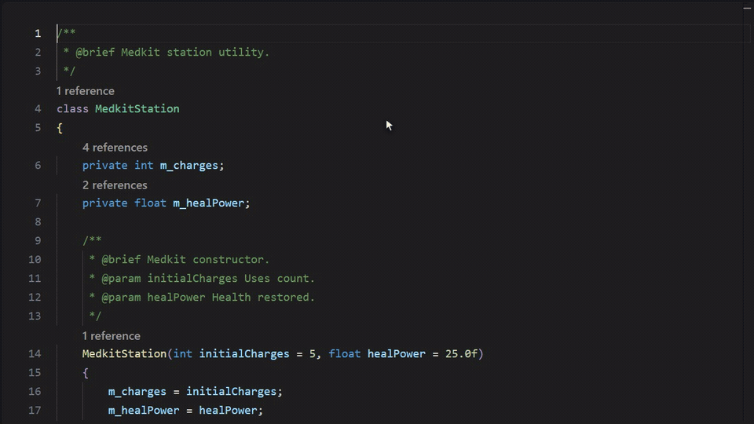</p>

### Rename

Change a script symbol's name and update its uses.

<p align="center">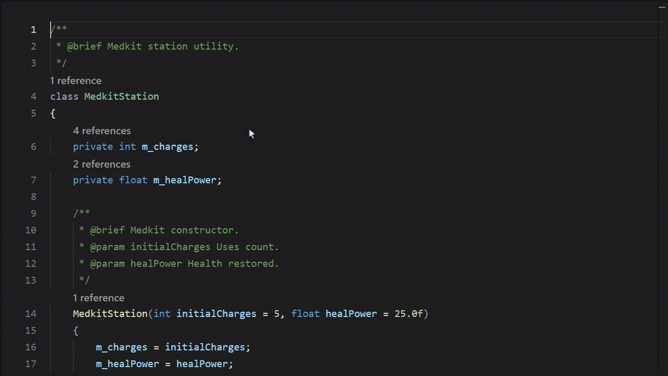</p>

### Code actions

Open the lightbulb to see fixes and refactorings.

<p align="center">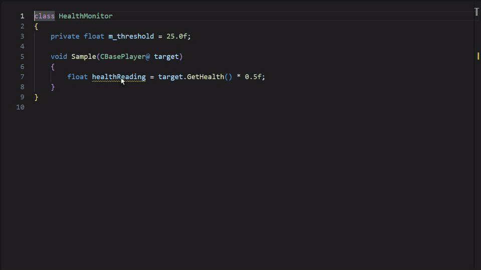</p>

### Formatting

Format the whole script or just the selected lines.

<p align="center">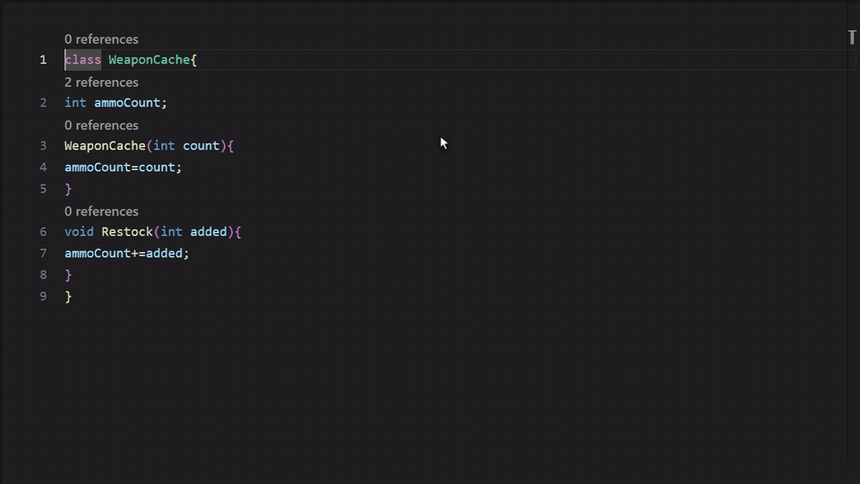</p>

### Inlay hints

See parameter names beside call arguments.

<p align="center">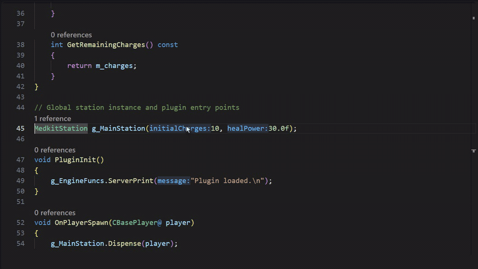</p>

### Code lens

See the reference count above a declaration.

<p align="center">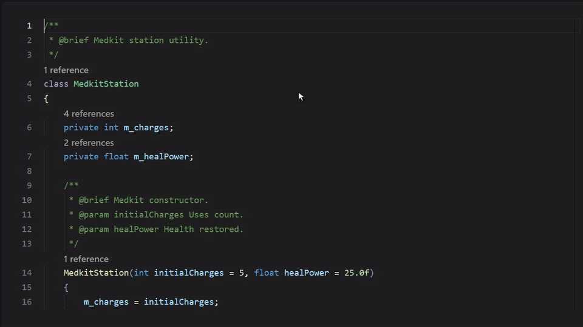</p>

### Outline

Browse the current script's classes, functions, and other symbols.

<p align="center">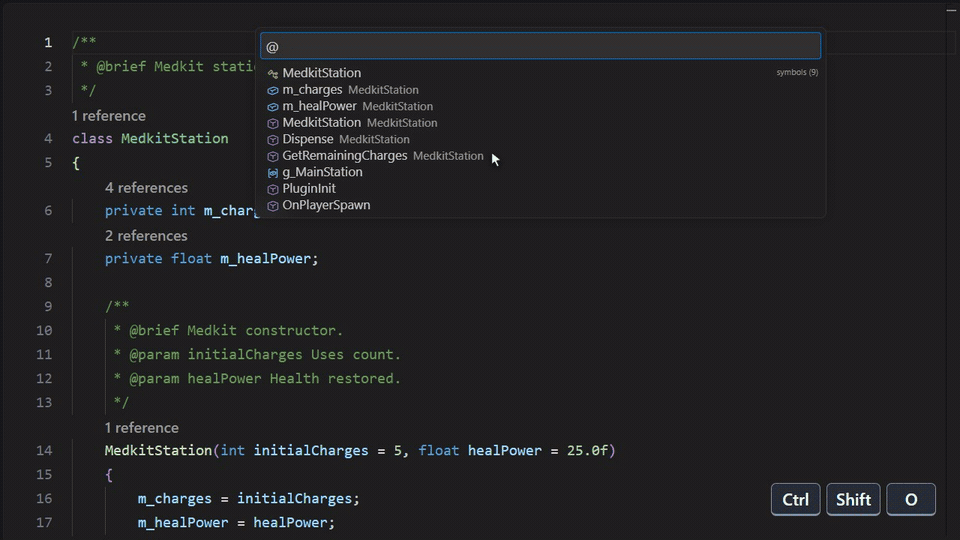</p>

### Semantic highlighting

See parameters and fields colored by what they represent.

<p align="center">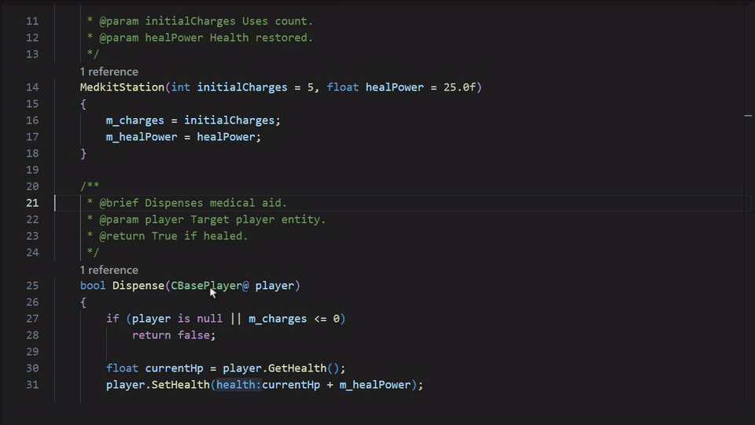</p>

### Host API

Get completion for the types and functions declared in your stub.

<p align="center">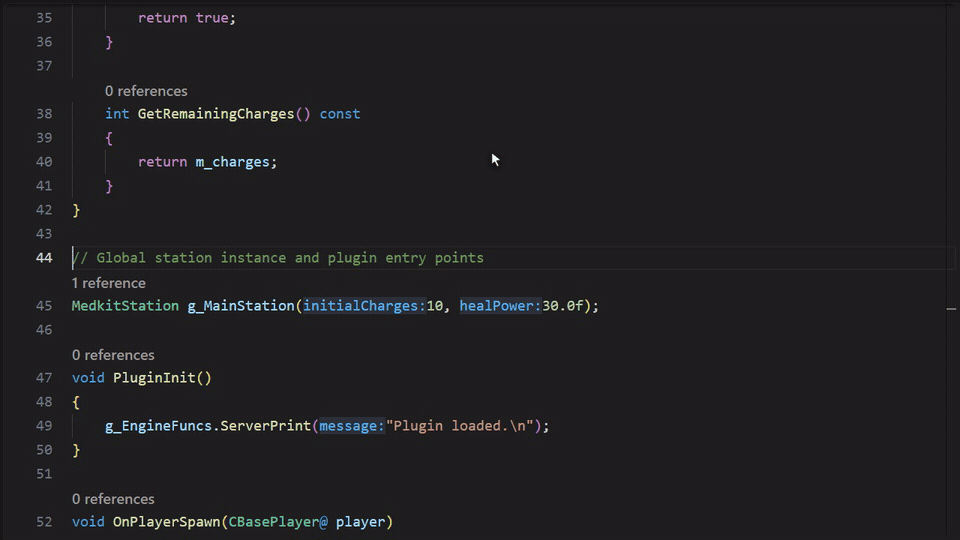</p>

### Engine rules

See your team's custom checks in the editor.

<p align="center">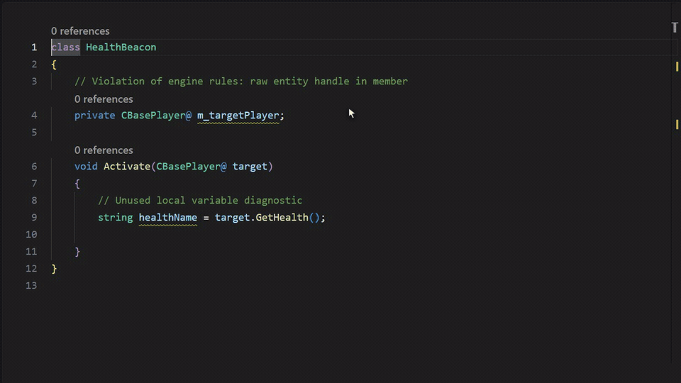</p>

### Engine options

Match the checks to the language options your host uses.

<p align="center">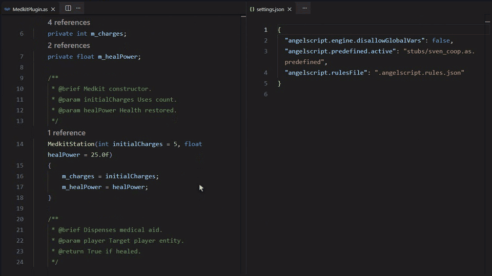</p>

<details>
<summary>Supported LSP features</summary>

| Feature | Status |
| :--- | :--- |
| Completion | ✅ |
| Hover | ✅ |
| Signature help | ✅ |
| Definition, declaration, and type definition | ✅ |
| References | ✅ |
| Rename | ✅ |
| Document and workspace symbols | ✅ |
| Semantic tokens | ✅ |
| Inlay hints | ✅ |
| Code actions | ✅ |
| Document and range formatting | ✅ |
| Push and pull diagnostics | ✅ |

</details>

## Host API stubs (.as.predefined)

In AngelScript, the host application registers its C++ API so your scripts can call its functions and use its types. AngelLSP loads `.as.predefined` stubs that describe those declarations for completion, hover, and diagnostics.

| Host | Stub | Notes |
| :--- | :--- | :--- |
| Sven Co-op | [Sven Co-op - Gaftherman](https://github.com/Gaftherman/angelscript-lsp/blob/main/predefined/sven.as.predefined) | **Recommended**. Actively maintained for Sven Co-op 5.26+ API bindings, with const-correct declarations, ref qualifiers, and math and engine structs. |
| Sven Co-op | [Sven Co-op - Sashi0034](https://github.com/sashi0034/angel-lsp/blob/main/examples/Sven%20Co-op/as.predefined) | **Legacy**. Kept for older projects. Its bindings are outdated for current engine releases. |
| Trackmania Nations Forever | [Trackmania Nations Forever - Sashi0034](https://github.com/sashi0034/angel-lsp/blob/main/examples/Trackmania%20Nations%20Forever/as.predefined) | Compatible. Includes bindings for `CGameCtnApp` and `MwFastBuffer`. |
| OpenSiv3D | [OpenSiv3D - Sashi0034](https://github.com/sashi0034/angel-lsp/blob/main/examples/OpenSiv3D/as.predefined) | Compatible. Includes bindings for `Vec2`, `ColorF`, and `Circle`. |

In `.vscode/settings.json`, set `"angelscript.predefined.active": "${workspaceFolder}/path/to/stub.as.predefined"` or use `"all"` to load every discovered stub. The default is `""`, which selects the first stub in path order. You can also run **AngelScript: Select Predefined Stub** or open the **AngelScript IntelliSense** status item to choose one.

<p align="center">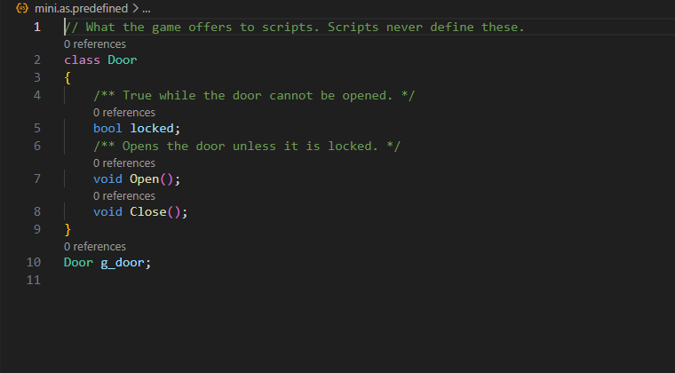</p>
<p align="center"><em>A stub declares a class and its methods for the editor.</em></p>

## Engine rules

Save `angelscript.rules.json` in the project root. Use the [Engine Rules Guide](https://github.com/Gaftherman/angelscript-lsp/blob/main/docs/RULES.md) to configure your project's checks.

## Engine options

Use `angelscript.engine.*` in VS Code to match your host's language options. For example, set `angelscript.engine.foreachSupport` to `false` if your host disables `foreach`.

## Debugger

Use breakpoints, view the call stack, and inspect variables with the VS Code debugger while scripts run in your host.
The [debugger example project](https://github.com/Gaftherman/angelscript-debugger-example) shows how to set up the host and run a complete debug session.

With a `launch` configuration, press F5 to start your host program and see its console output in the VS Code Debug Console, as shown in the example project.

<p align="center"></p>
<p align="center"><em>Step through an AngelScript script in VS Code.</em></p>

## Documentation

- [Detailed Guide](https://github.com/Gaftherman/angelscript-lsp/blob/main/docs/GUIDE.md) — workspace examples, predefined files, engine options, and commands.
- [Configuration Guide](https://github.com/Gaftherman/angelscript-lsp/blob/main/docs/CONFIGURATION.md) — settings and editor examples.
- [Engine Rules Guide](https://github.com/Gaftherman/angelscript-lsp/blob/main/docs/RULES.md) — custom checks and shared engine settings.
- [CHANGELOG.md](CHANGELOG.md) — release history and changes.

## Building from source

```bash
cmake -B server/build -S server -DCMAKE_BUILD_TYPE=Release
cmake --build server/build --config Release
ctest --test-dir server/build -C Release --output-on-failure
cd client && npm install && npm run compile && npm run bundle
```

Licensed under the [MIT License](LICENSE).
