# Angelscript para VS Code

**[English](../README.md)** | **[Español](README.es.md)**

[](https://marketplace.visualstudio.com/items?itemName=Gaftherman.angelscript-gaftherman)
[](https://marketplace.visualstudio.com/items?itemName=Gaftherman.angelscript-gaftherman)
[](https://opensource.org/licenses/MIT)
[](https://hub.xerj.org/contributors/Gaftherman)

Angelscript añade a VS Code un servidor de lenguaje nativo en C++20 para AngelScript (`.as`). Usa Tree-Sitter para analizar los scripts e indexar sus símbolos. Analiza el espacio de trabajo a partir de los árboles de sintaxis, sin ejecutar el motor del juego ni concatenar los scripts.

Úsalo con Sven Co-op, con otros motores de juegos o con tu propia integración de `CScriptBuilder`. Tienes información al pasar el cursor, autocompletado, navegación, comprobaciones de nulos que siguen el flujo del código e inferencia de tipos en todo el espacio de trabajo.

<p align="center">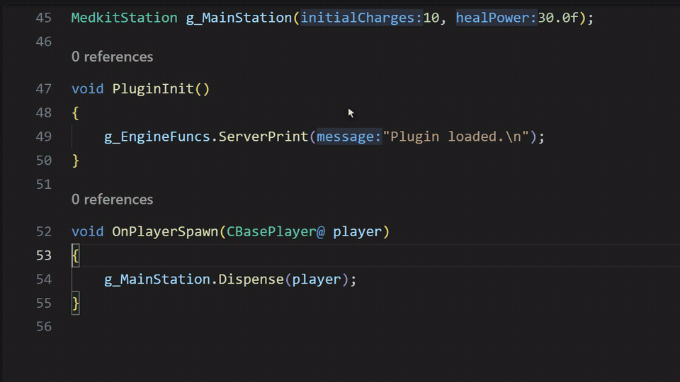<br><em>Pasa el cursor sobre una llamada para ver su firma y su comentario de documentación.</em></p>

## Instalación

Instala la extensión desde [Visual Studio Code Marketplace](https://marketplace.visualstudio.com/items?itemName=Gaftherman.angelscript-gaftherman) o busca **Angelscript** de Gaftherman en Extensiones (`Ctrl+Shift+X`). También puedes pulsar `Ctrl+P`, pegar `ext install Gaftherman.angelscript-gaftherman` y pulsar Intro.

Para instalar un VSIX, pulsa `Ctrl+Shift+P`, ejecuta **Extensiones: Instalar desde VSIX...** (**Extensions: Install from VSIX...**) y elige `angelscript-*.vsix`.

1. Abre una carpeta con archivos `.as`.
2. Si tu juego ofrece tipos o funciones propias, puedes añadir un stub `.as.predefined`.
3. Si tu proyecto necesita comprobaciones propias o ajustes compartidos del motor, puedes añadir un archivo `angelscript.rules.json`.

## Funciones

<div align="center">

| Función | Estado |
| :--- | :--- |
| Autocompletado | ✅ |
| Información al pasar el cursor | ✅ |
| Ayuda de firma | ✅ |
| Definición, declaración y definición de tipo | ✅ |
| Referencias | ✅ |
| Renombrado | ✅ |
| Símbolos del documento y del espacio de trabajo | ✅ |
| Tokens semánticos | ✅ |
| Pistas en línea | ✅ |
| Acciones de código | ✅ |
| Formato del documento y de la selección | ✅ |
| Diagnósticos enviados por el servidor y bajo demanda | ✅ |

</div>

<table>
<tr><td><strong>Información al pasar el cursor</strong><br>Consulta la firma y la documentación de un símbolo.<br></td>
<td><strong>Autocompletado</strong><br>Escribe después de un punto para ver los miembros disponibles.<br>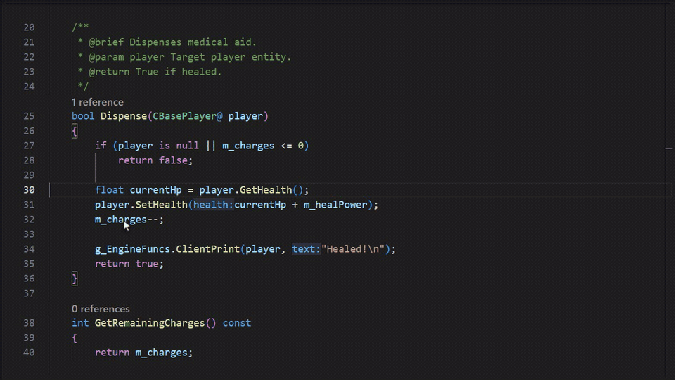</td></tr>
<tr><td><strong>Ayuda de firma</strong><br>Consulta qué parámetro estás completando mientras escribes una llamada.<br>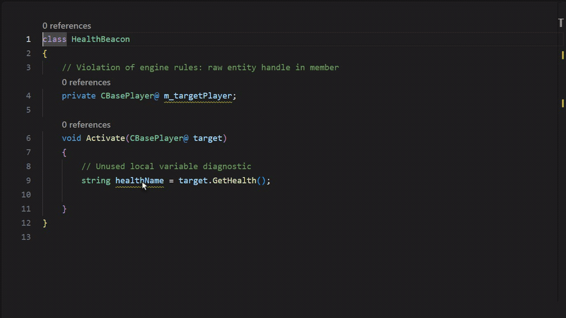</td>
<td><strong>Diagnósticos</strong><br>Ve avisos en el editor, como los de variables sin usar.<br>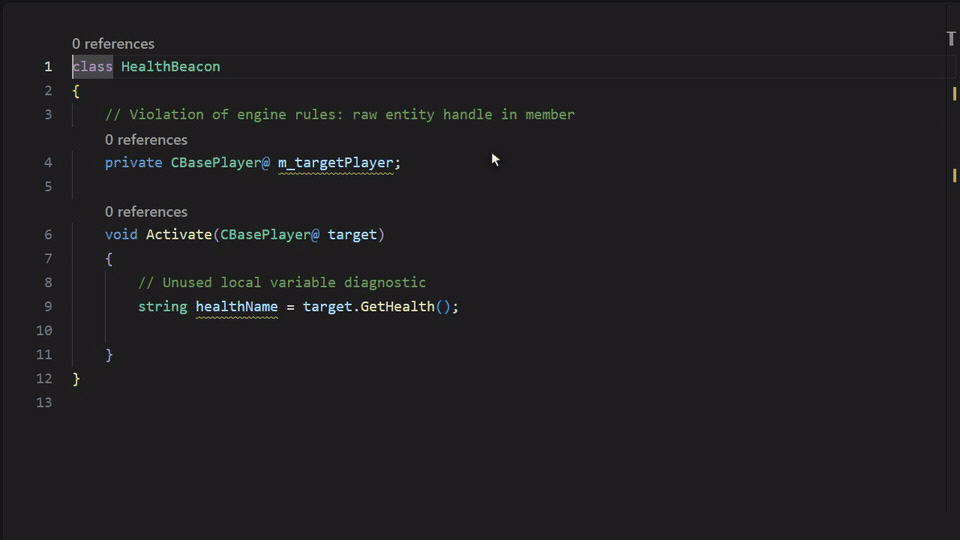</td></tr>
<tr><td><strong>Ir a la definición</strong><br>Salta desde un nombre hasta su definición.<br></td>
<td><strong>Buscar todas las referencias</strong><br>Consulta dónde se usa un símbolo.<br>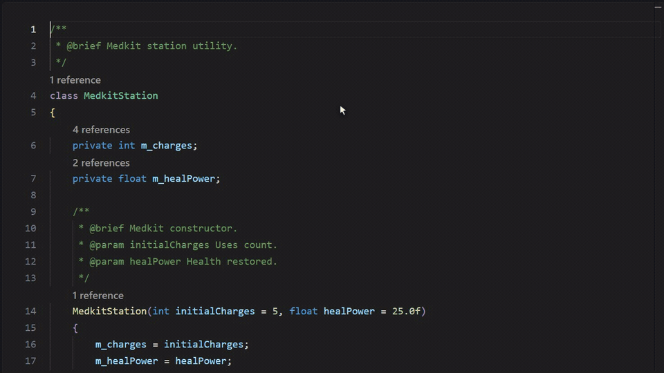</td></tr>
<tr><td><strong>Cambiar nombre</strong><br>Cambia el nombre de un símbolo del script y actualiza sus usos.<br></td>
<td><strong>Acciones de código</strong><br>Abre la bombilla para ver correcciones y refactorizaciones.<br></td></tr>
<tr><td><strong>Formato</strong><br>Da formato a todo el script o solo a las líneas seleccionadas.<br>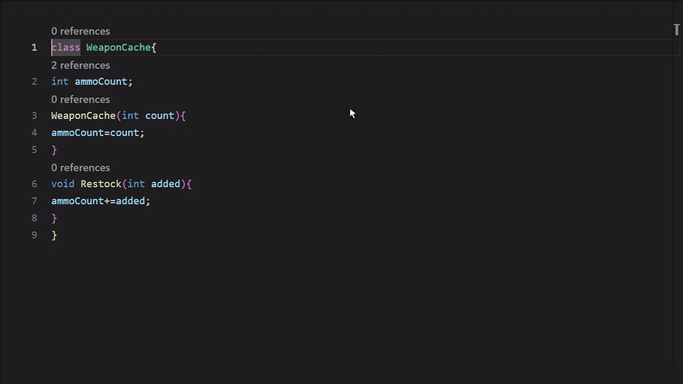</td>
<td><strong>Pistas en línea</strong><br>Ve los nombres de los parámetros junto a los argumentos de una llamada.<br>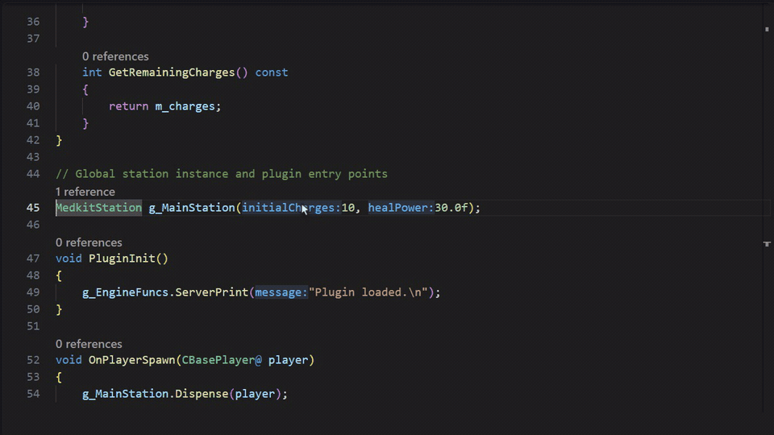</td></tr>
<tr><td><strong>CodeLens</strong><br>Ve cuántas referencias hay encima de una declaración.<br>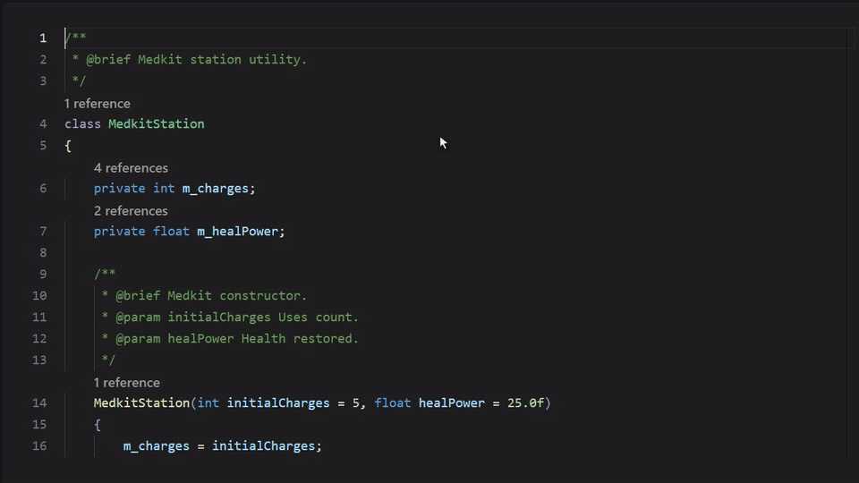</td>
<td><strong>Esquema</strong><br>Explora las clases, funciones y demás símbolos del script abierto.<br></td></tr>
<tr><td><strong>Resaltado semántico</strong><br>Distingue los parámetros y los campos por sus colores.<br>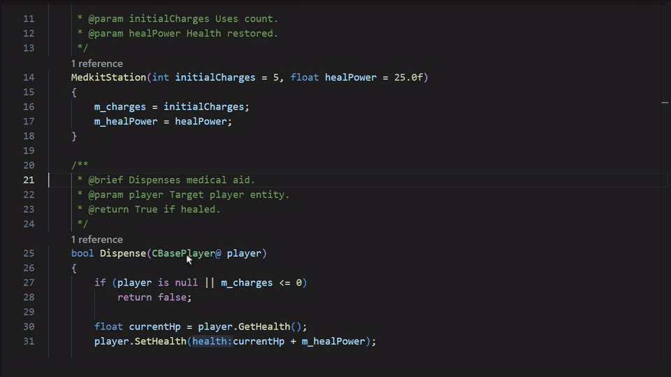</td>
<td><strong>API del host</strong><br>Obtén sugerencias para los tipos y funciones que declara tu stub.<br>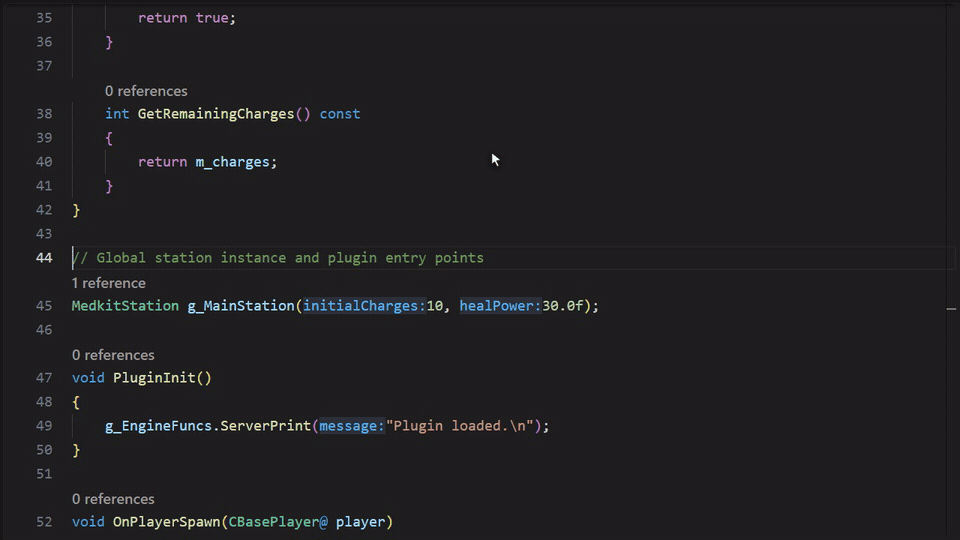</td></tr>
<tr><td><strong>Reglas del motor</strong><br>Ve en el editor los avisos de las comprobaciones de tu equipo.<br>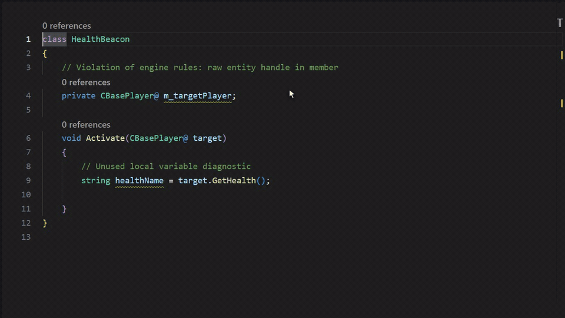</td>
<td><strong>Opciones del motor</strong><br>Adapta las comprobaciones a las opciones de lenguaje de tu motor.<br>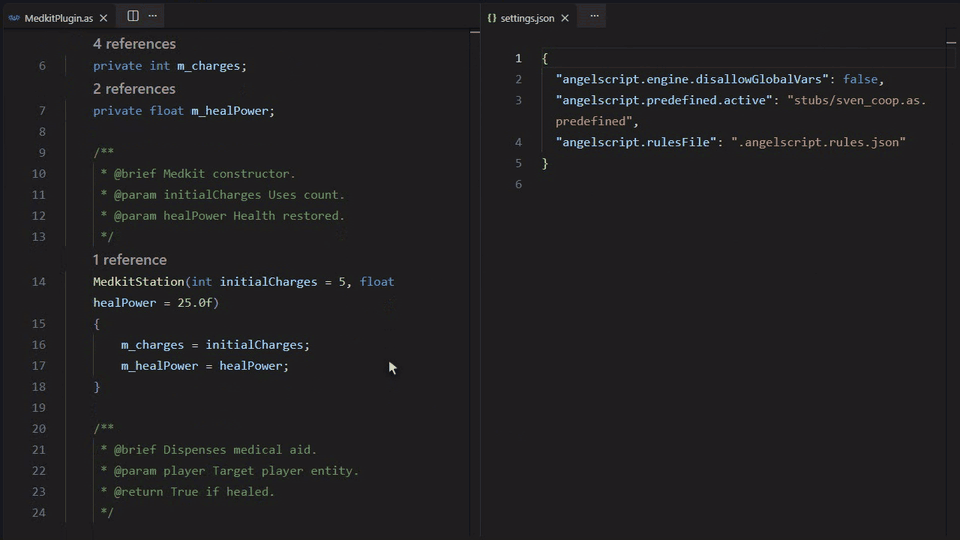</td></tr>
</table>

## Stubs de la API del host (.as.predefined)

En AngelScript, la aplicación anfitriona registra su API de C++ para que tus scripts puedan llamar a sus funciones y usar sus tipos. AngelLSP carga stubs `.as.predefined` que describen esas declaraciones para el autocompletado, la información al pasar el cursor y los diagnósticos.

| Host | Stub | Notas |
| :--- | :--- | :--- |
| Sven Co-op | [Sven Co-op - Gaftherman](https://github.com/Gaftherman/angelscript-lsp/blob/main/predefined/sven.as.predefined) | **Recomendado**. Se mantiene al día para la API de Sven Co-op 5.26 y posteriores. Incluye declaraciones con `const` donde corresponde, calificadores de referencia y estructuras matemáticas y del motor. |
| Sven Co-op | [Sven Co-op - Sashi0034](https://github.com/sashi0034/angel-lsp/blob/main/examples/Sven%20Co-op/as.predefined) | **Antiguo**. Se conserva para proyectos anteriores. Sus declaraciones están desactualizadas con respecto a las versiones actuales del motor. |
| Trackmania Nations Forever | [Trackmania Nations Forever - Sashi0034](https://github.com/sashi0034/angel-lsp/blob/main/examples/Trackmania%20Nations%20Forever/as.predefined) | Compatible. Incluye declaraciones para `CGameCtnApp` y `MwFastBuffer`. |
| OpenSiv3D | [OpenSiv3D - Sashi0034](https://github.com/sashi0034/angel-lsp/blob/main/examples/OpenSiv3D/as.predefined) | Compatible. Incluye declaraciones para `Vec2`, `ColorF` y `Circle`. |

En `.vscode/settings.json`, pon `"angelscript.predefined.active": "${workspaceFolder}/path/to/stub.as.predefined"` o usa `"all"` para cargar todos los stubs que encuentre el servidor. El valor predeterminado es `""` y selecciona el primer stub por orden de ruta. También puedes ejecutar **AngelScript: Seleccionar stub predefinido** o abrir el indicador de estado **AngelScript IntelliSense** para elegir uno.

<p align="center"></p>

<p align="center">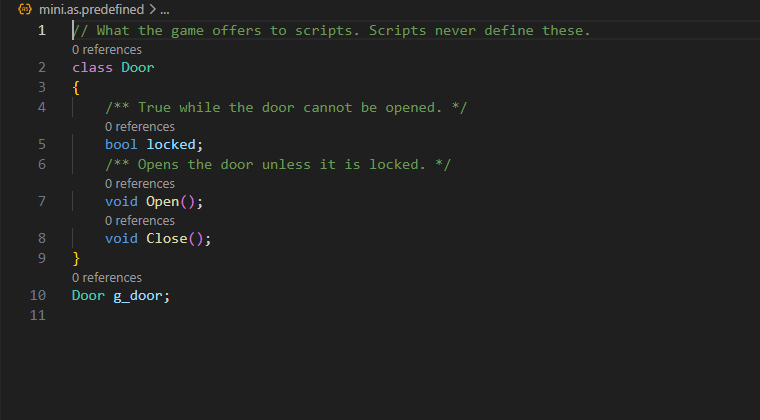</p>

## Reglas del motor

Pon un archivo `angelscript.rules.json` en la raíz del espacio de trabajo para compartir los ajustes del motor y añadir tus propias comprobaciones. Por ejemplo, puedes mostrar un aviso si un campo de una clase usa un tipo determinado.

<p align="center"></p>

<p align="center"></p>

## Opciones del motor

Usa los ajustes `angelscript.engine.*` de VS Code para que coincidan con las opciones de tu motor. Por ejemplo, pon `angelscript.engine.foreachSupport` en `false` si tu motor desactiva `foreach`.

<p align="center"></p>

## Depurador

El depurador de VS Code se conecta a tu juego o aplicación anfitriona para que puedas depurar los scripts mientras se ejecutan. Inicia el host con [asdebugger](https://github.com/Gaftherman/asdebugger) escuchando en `127.0.0.1:9002`. Guarda esto como `.vscode/launch.json` y elige la configuración en **Ejecutar y depurar**.

```json
{
  "version": "0.2.0",
  "configurations": [
    {
      "name": "Conectar al juego",
      "type": "angelscript",
      "request": "attach",
      "port": 9002,
      "protocol": "dap"
    }
  ]
}
```

Consulta el [proyecto de ejemplo del depurador](https://github.com/Gaftherman/angelscript-debugger-example) para ver cómo configurar un host.

## Documentación

- [Guía detallada](GUIDE.es.md) — ejemplos de espacio de trabajo, archivos predefinidos, opciones del motor y comandos.
- [Guía de configuración](CONFIGURATION.es.md) — ajustes y ejemplos para editores.
- [Guía de reglas del motor](RULES.es.md) — cómo escribir archivos `*.angelscript.rules.json`.
- [CHANGELOG.md](../CHANGELOG.md) — historial de versiones y cambios.

## Compilar desde el código fuente

```bash
cmake -B server/build -S server -DCMAKE_BUILD_TYPE=Release
cmake --build server/build --config Release
ctest --test-dir server/build -C Release --output-on-failure
cd client && npm install && npm run compile && npm run bundle
```

Bajo licencia [MIT](../LICENSE).
