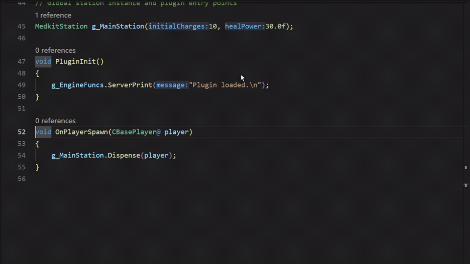
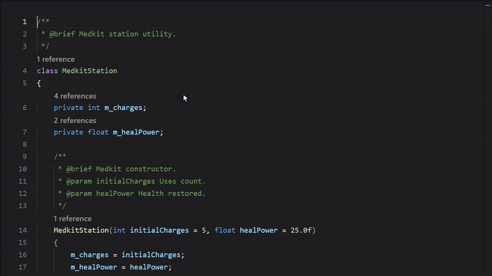
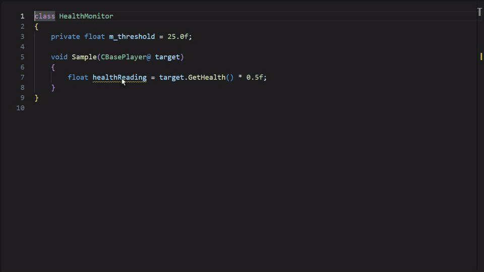
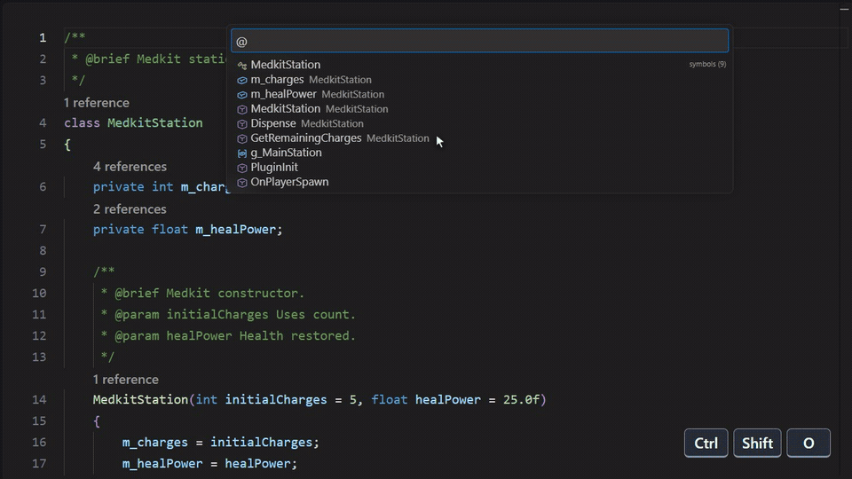

# Angelscript para VS Code

**[English](../README.md)** | **[Español](README.es.md)**

[](https://marketplace.visualstudio.com/items?itemName=Gaftherman.angelscript-gaftherman)
[](https://marketplace.visualstudio.com/items?itemName=Gaftherman.angelscript-gaftherman)
[](https://opensource.org/licenses/MIT)
[](https://hub.xerj.org/contributors/Gaftherman)

Angelscript añade compatibilidad con archivos `.as` en VS Code.

Los juegos y las aplicaciones que integran AngelScript lo usan para ejecutar código de plugins y mods. La extensión muestra documentación al pasar el cursor, ofrece autocompletado y marca errores mientras escribes.

El servidor de lenguaje, escrito en C++20, usa Tree-Sitter para analizar los scripts e indexar sus símbolos.

<p align="center"></p>
<p align="center"><em>Pasa el cursor sobre una llamada a un método para ver su documentación.</em></p>

<table align="center">
  <tr>
    <td align="center"></td>
    <td align="center"></td>
  </tr>
  <tr>
    <td align="center"><code>.as</code><br>script</td>
    <td align="center"><code>.as.predefined</code><br>stub de la API del host</td>
  </tr>
</table>

## Instalación

Instala la extensión desde [Visual Studio Code Marketplace](https://marketplace.visualstudio.com/items?itemName=Gaftherman.angelscript-gaftherman) o busca **Angelscript** de Gaftherman en Extensiones (`Ctrl+Shift+X`). También puedes pulsar `Ctrl+P`, pegar `ext install Gaftherman.angelscript-gaftherman` y pulsar Intro.

Para instalar un VSIX, pulsa `Ctrl+Shift+P`, ejecuta **Extensiones: Instalar desde VSIX...** (**Extensions: Install from VSIX...**) y elige `angelscript-*.vsix`.

### Pruébalo en 30 segundos

Abre una carpeta en VS Code, crea `hello.as` y pega este código. Mientras escribes, la extensión revisa el código, muestra documentación al pasar el cursor, ofrece sugerencias de autocompletado y subraya los errores.

```angelscript
class Calculator {
    /// Devuelve el doble de un número.
    int twice(int number) { return number * 2; }
}
void Run() {
    Calculator calc;
    calc.twice(21);
}
```

Pasa el cursor sobre `twice` en `calc.twice(21)` para ver la firma y el comentario de documentación. Escribe `calc.` para ver qué miembros sugiere el editor. Cambia la llamada original a `calc.twcie(21)` para que el editor subraye el error.

La extensión no ejecuta scripts. Los scripts de AngelScript se ejecutan dentro de una aplicación anfitriona, como un juego. Consulta [Depurador](#depurador) para ejecutar y depurar scripts en esa aplicación.

### Descargas

Cada [release](https://github.com/angelscript-tools/angelscript-lsp/releases) incluye estos archivos:

| Archivo | Para qué sirve |
| --- | --- |
| `angelscript.vsix` | VS Code. Incluye el servidor de todas las plataformas compatibles. |
| `angel_lsp-<versión>-<plataforma>.zip` o `.tar.gz` | Otros editores (Neovim, Helix, Zed, Emacs). Cada archivo contiene el servidor `angel_lsp` de una plataforma. |
| `SHA256SUMS` | Sumas de verificación de todos los archivos anteriores. |

Plataformas: `windows-x64`, `windows-x86`, `linux-x64`, `linux-x86`, `macos-x64`, `macos-arm64`. Pon `angel_lsp` en el `PATH` y ejecútalo sin argumentos; habla el Language Server Protocol por stdio y se aplica a los archivos `.as`.

Agentes de IA: el servidor MCP es un proyecto aparte, [angelscript-mcp](https://github.com/angelscript-tools/angelscript-mcp). `angel_lsp --mcp` está obsoleto.

## Funciones

### Información al pasar el cursor

<p align="center"></p>
<p align="center"><em>Consulta la firma y la documentación de un símbolo.</em></p>

### Autocompletado

<p align="center"></p>
<p align="center"><em>Escribe después de un punto para ver los miembros disponibles.</em></p>

### Ayuda de firma

<p align="center"></p>
<p align="center"><em>Consulta qué parámetro estás completando mientras escribes una llamada.</em></p>

### Diagnósticos

<p align="center"></p>
<p align="center"><em>Ve avisos en el editor, como los de variables sin usar.</em></p>

### Ir a la definición

<p align="center"></p>
<p align="center"><em>Salta desde un nombre hasta su definición.</em></p>

### Buscar todas las referencias

<p align="center"></p>
<p align="center"><em>Consulta dónde se usa un símbolo.</em></p>

### Cambiar nombre

<p align="center"></p>
<p align="center"><em>Cambia el nombre de un símbolo del script y actualiza sus usos.</em></p>

### Acciones de código

<p align="center"></p>
<p align="center"><em>Abre la bombilla para ver correcciones y refactorizaciones.</em></p>

### Formato

<p align="center"></p>
<p align="center"><em>Da formato a todo el script o solo a las líneas seleccionadas.</em></p>

### Pistas en línea

<p align="center"></p>
<p align="center"><em>Ve los nombres de los parámetros junto a los argumentos de una llamada.</em></p>

### CodeLens

<p align="center"></p>
<p align="center"><em>Ve cuántas referencias hay encima de una declaración.</em></p>

### Esquema

<p align="center"></p>
<p align="center"><em>Explora las clases, funciones y demás símbolos del script abierto.</em></p>

### Resaltado semántico

<p align="center"></p>
<p align="center"><em>Distingue los parámetros y los campos por sus colores.</em></p>

### API del host

<p align="center"></p>
<p align="center"><em>Obtén sugerencias para los tipos y funciones que declara tu stub.</em></p>

### Reglas del motor

<p align="center"></p>
<p align="center"><em>Ve en el editor los avisos de las comprobaciones de tu equipo.</em></p>

### Opciones del motor

<p align="center"></p>
<p align="center"><em>Adapta las comprobaciones a las opciones de lenguaje de tu motor.</em></p>

<details>
<summary>Funciones LSP compatibles</summary>

| Categoría | Función | Qué hace |
| :--- | :--- | :--- |
| ✏️ Edición | Autocompletado | Sugiere símbolos y miembros mientras escribes. |
|  | Información al pasar el cursor | Muestra firmas y documentación al pasar el cursor. |
|  | Ayuda de firma | Muestra la firma y resalta el parámetro activo. |
|  | Renombrado | Renombra un símbolo y actualiza sus usos. |
|  | Pistas en línea | Muestra nombres de parámetros y tipos inferidos. |
|  | Acciones de código | Ofrece correcciones rápidas y refactorizaciones. |
|  | Formato del documento y de la selección | Formatea el script completo o las líneas seleccionadas. |
| 🧭 Navegación | Definición, declaración y definición de tipo | Abre declaraciones, definiciones o definiciones de tipo. |
|  | Referencias | Encuentra dónde se usa un símbolo. |
|  | Símbolos del documento y del espacio de trabajo | Enumera símbolos del archivo o espacio de trabajo. |
| 🔎 Análisis | Tokens semánticos | Resalta los símbolos según su función. |
|  | Diagnósticos enviados por el servidor y bajo demanda | Notifica errores y avisos automáticamente o bajo demanda. |

</details>

## Stubs de la API del host (.as.predefined)

En AngelScript, la aplicación anfitriona registra su API de C++ para que tus scripts puedan llamar a sus funciones y usar sus tipos. AngelLSP carga stubs `.as.predefined` que describen esas declaraciones para el autocompletado, la información al pasar el cursor y los diagnósticos.

| Host | Stub | Notas |
| :--- | :--- | :--- |
| Sven Co-op | [Sven Co-op - Gaftherman](https://github.com/angelscript-tools/angelscript-lsp/blob/main/predefined/sven.as.predefined) | **Recomendado**. Se mantiene al día para la API de Sven Co-op 5.26 y posteriores. Incluye declaraciones con `const` donde corresponde, calificadores de referencia y estructuras matemáticas y del motor. |
| Sven Co-op | [Sven Co-op - Sashi0034](https://github.com/sashi0034/angel-lsp/blob/main/examples/Sven%20Co-op/as.predefined) | **Antiguo**. Se conserva para proyectos anteriores. Sus declaraciones están desactualizadas con respecto a las versiones actuales del motor. |
| Trackmania Nations Forever | [Trackmania Nations Forever - Sashi0034](https://github.com/sashi0034/angel-lsp/blob/main/examples/Trackmania%20Nations%20Forever/as.predefined) | Compatible. Incluye declaraciones para `CGameCtnApp` y `MwFastBuffer`. |
| OpenSiv3D | [OpenSiv3D - Sashi0034](https://github.com/sashi0034/angel-lsp/blob/main/examples/OpenSiv3D/as.predefined) | Compatible. Incluye declaraciones para `Vec2`, `ColorF` y `Circle`. |

En `.vscode/settings.json`, pon `"angelscript.predefined.active": "${workspaceFolder}/path/to/stub.as.predefined"` o usa `"all"` para cargar todos los stubs que encuentre el servidor. El valor predeterminado es `""` y selecciona el primer stub por orden de ruta. También puedes ejecutar **AngelScript: Seleccionar stub predefinido** o abrir el indicador de estado **AngelScript IntelliSense** para elegir uno.

<p align="center"></p>
<p align="center"><em>Un stub declara una clase y sus métodos para el editor.</em></p>

## Reglas del motor

Guarda `angelscript.rules.json` en la raíz del proyecto. Usa la [guía de reglas del motor](RULES.es.md) para configurar las comprobaciones de tu proyecto. AngelScript **2.39.0**, la última versión, es la versión del motor con soporte. Si tu host usa otra, decláralo con la sección `engine` (`{"engine": {"version": "2.36.1"}}`) y el servidor avisa de las propiedades del motor que esa versión no tiene. La [CLI](https://github.com/angelscript-tools/angelscript-cli/blob/main/docs/ENGINE_VERSIONS.md) indica con qué versiones oficiales compila y prueba.

## Opciones del motor

Usa los ajustes `angelscript.engine.*` de VS Code para que coincidan con las opciones de tu motor. Por ejemplo, pon `angelscript.engine.foreachSupport` en `false` si tu motor desactiva `foreach`.

## Depurador

La depuración vive en sus propios proyectos, para que cualquier aplicación pueda usarla. [angelscript-dap](https://github.com/angelscript-tools/angelscript-dap) es el depurador, el [proyecto de ejemplo](https://github.com/angelscript-tools/angelscript-debugger-example) muestra una aplicación completa y la configuración de VS Code, y la [CLI de AngelScript](https://github.com/angelscript-tools/angelscript-cli) ejecuta y depura scripts desde la terminal con `angelscript --dap-port 9002 script.as`.

Añade una configuración `attach` o `launch` de tipo `angelscript` a `launch.json`, pon puntos de interrupción en tus archivos `.as` y pulsa F5.

<p align="center"></p>

## Compilar desde el código fuente

```bash
cmake -B server/build -S server -DCMAKE_BUILD_TYPE=Release
cmake --build server/build --config Release
ctest --test-dir server/build -C Release --output-on-failure
cd client && npm install && npm run compile && npm run bundle
```

## Documentación

- [Guía detallada](GUIDE.es.md) — ejemplos de espacio de trabajo, archivos predefinidos, opciones del motor y comandos.
- [Guía de configuración](CONFIGURATION.es.md) — ajustes y ejemplos para editores.
- [Guía de reglas del motor](RULES.es.md) — comprobaciones propias y ajustes compartidos del motor.
- [CHANGELOG.md](../CHANGELOG.md) — historial de versiones y cambios.

## Hoja de ruta

- Cerrar la auditoría del código y pasar los controles de calidad en la rama de refactorización de la arquitectura.
- Mantener los diagnósticos alineados con el compilador oficial de AngelScript.
- Dar soporte a más hosts mediante stubs `.as.predefined`.

El avance se registra en [CHANGELOG.md](../CHANGELOG.md).

## Soporte

Los reportes de errores y las sugerencias son bienvenidos en [GitHub Issues](https://github.com/angelscript-tools/angelscript-lsp/issues). Cuando el servidor falla, ejecuta **AngelScript: Report Issue** (o pulsa **Report Issue** en el mensaje de error). Abre el formulario con tus versiones, el registro y una pequeña muestra anonimizada de tu código ya rellenos, para que revises todo antes de enviarlo.

Si corriges un error pequeño o añades una mejora, puedes enviar un pull request. [CONTRIBUTING.es.md](CONTRIBUTING.es.md) explica cómo compilar y comprobar un cambio. Si creas un archivo `.as.predefined` para tu aplicación, contribuirlo como ejemplo se agradecería mucho.

## Relacionados

| Proyecto | Uso |
| --- | --- |
| [angelscript-cli](https://github.com/angelscript-tools/angelscript-cli) | Ejecuta, comprueba y depura scripts desde la terminal |
| [angelscript-dap](https://github.com/angelscript-tools/angelscript-dap) | Núcleo del depurador |
| [angelscript-debugger-example](https://github.com/angelscript-tools/angelscript-debugger-example) | Un host que muestra cómo usar el depurador |
| [angelscript-jit](https://github.com/angelscript-tools/angelscript-jit) | Compilador JIT opcional |
| [angelscript-engine](https://github.com/angelscript-tools/angelscript-engine) | Soporte de versiones antiguas de AngelScript |

### Proyectos similares

Existen otras herramientas para AngelScript. Si esta no encaja con tu proyecto, te recomendamos abiertamente probarlas:

- [sashi0034/angel-lsp](https://github.com/sashi0034/angel-lsp): otro servidor de lenguaje de AngelScript para VS Code, con una implementación para IntelliJ. Sus [ejemplos](https://github.com/sashi0034/angel-lsp/tree/main/examples) incluyen stubs de hosts.

## Créditos

Angelscript para VS Code se apoya en el trabajo de estos proyectos. Sus licencias se reproducen en [THIRD_PARTY_NOTICES.md](THIRD_PARTY_NOTICES.md).

| Proyecto | Licencia | Uso |
| --- | --- | --- |
| [Relrin/tree-sitter-angelscript](https://github.com/Relrin/tree-sitter-angelscript) | BSD-3-Clause | Base de la gramática de AngelScript. Este proyecto mantiene un [fork](https://github.com/angelscript-tools/tree-sitter-angelscript). |
| [AngelScript](https://github.com/anjo76/angelscript) by Andreas Jönsson | zlib | El lenguaje en sí. Su compilador es el oráculo de pruebas de los diagnósticos. |
| [tree-sitter](https://github.com/tree-sitter/tree-sitter) | MIT | Análisis incremental. |
| [tree-sitter-doxygen](https://github.com/tree-sitter-grammars/tree-sitter-doxygen) | MIT | Comentarios de documentación. |
| [lsp-framework](https://github.com/leon-bckl/lsp-framework) | MIT | Biblioteca del Language Server Protocol. |
| [nlohmann/json](https://github.com/nlohmann/json) | MIT | JSON. |
| [spdlog](https://github.com/gabime/spdlog) | MIT | Registro de eventos. |
| [unordered_dense](https://github.com/martinus/unordered_dense) | MIT | Contenedores hash. |
| [doctest](https://github.com/doctest/doctest) | MIT | Framework de pruebas. |

## Licencia

Este repositorio está bajo la [licencia MIT](../LICENSE).
