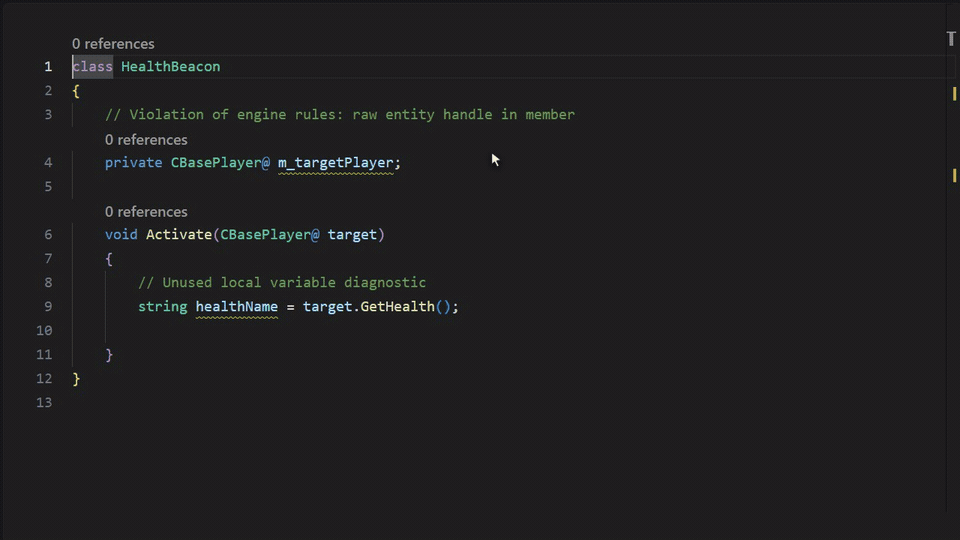

# Reglas del motor de AngelScript

[English](RULES.md) | [Español](RULES.es.md)



*Una regla de almacenamiento marca un handle en un campo.*

Un archivo de reglas le indica a la extensión qué tipos del motor o handles de objetos debe señalar, dónde se pueden usar y qué mensaje mostrar. También permite ajustar el análisis a las opciones del motor e indicar qué funciones llama directamente el juego o la aplicación anfitriona.


*Un archivo JSON con opciones del motor y una regla de almacenamiento.*

## Dónde guardar el archivo

Guarda `angelscript.rules.json` en la raíz del espacio de trabajo. Para elegir un archivo concreto, pon `"angelscript.rulesFile": "${workspaceFolder}/config/game.angelscript.rules.json"` en `.vscode/settings.json`. El valor predeterminado es `""`.

El servidor carga un solo archivo. Busca primero en la ruta configurada, luego el nombre exacto en la raíz, después junto al stub activo y los demás stubs conocidos, y por último cualquier `*.angelscript.rules.json` en la raíz. Junto a `game.as.predefined` busca primero `game.angelscript.rules.json` y luego el primer archivo que coincida con el patrón, por orden de ruta.

Para crear una plantilla, ejecuta **Configurar reglas del motor y API predefinida...** (`angelscript.configureHostEnvironment`) en la paleta de comandos y elige **Crear plantilla angelscript.rules.json en el espacio de trabajo**.

## Ejemplos completos

Un handle es una referencia a un objeto. Escribe `@` después del tipo para declarar un handle.

### Prohibir un handle en un campo de clase

Abre una carpeta vacía en VS Code y guarda este archivo como `angelscript.rules.json` en la raíz.

```json
{
  "$schema": "https://raw.githubusercontent.com/Gaftherman/angelscript-lsp/main/schemas/angelscript.rules.schema.json",
  "storageRules": [
    {
      "id": "entity-member-handle",
      "types": ["CBaseEntity"],
      "handleOnly": true,
      "disallowInMembers": true,
      "suggestReplacement": "EHandle",
      "message": "El campo '{}' guarda un handle de entidad. Usa '{}'."
    }
  ]
}
```

Guarda este código como `main.as` en la misma carpeta.

```angelscript
class CBaseEntity {}
class Tracker { CBaseEntity@ target; }
```

VS Code marca `target` con el aviso `W113`. «El campo 'target' guarda un handle de entidad. Usa 'EHandle'.» Abre el panel **Problemas** (`Ctrl+Shift+M`) para verlo en la lista.

Si no aparece el aviso, abre **Ver → Salida** y selecciona **AngelScript C++ Language Server**.

### Prohibir handles para un tipo por valor

```json
{
  "noHandleTypes": ["string"]
}
```

Si tu host declara `string` en un stub `.as.predefined`, `string@ label;` genera `E261` porque el tipo de la lista no admite `@`.

### Señalar una llamada a un método del motor

```json
{
  "callRules": [
    {
      "id": "avoid-recorder-reset",
      "receiverTypes": ["Recorder"],
      "methods": ["Reset"],
      "disallowMethod": true,
      "message": "Usa Stop en lugar de Reset."
    }
  ]
}
```

`recorder.Reset()` genera `W121` con el aviso configurado si `Reset` se resuelve como método de `Recorder`.

## Referencia de campos

Las listas, los mapas y las cadenas opcionales están vacíos de forma predeterminada, salvo que se indique otro valor.

| Campo | Para qué sirve | Ejemplo |
| --- | --- | --- |
| `$schema` | Activa la validación y las sugerencias de propiedades JSON en VS Code. | Usa la URL del primer ejemplo. |
| `name` | Da un nombre descriptivo al conjunto de reglas. | `"Reglas del motor del juego"` |
| `noHandleTypes` | Genera `E261` (`as-err-handle-on-no-handle-type`) al usar handles con los tipos de la lista, incluidos sus alias `typedef`. Se combina con `angelscript.engine.noHandleTypes` y `--no-handle-type=<name>`. | `["string", "Game::Value"]` |
| `engine` | Declara el motor AngelScript que usa el host: `version` (por defecto `2.39.0`, la última versión y la que tiene soporte completo), `source` (`official` para una versión sin modificar, `custom` para un motor modificado) y `name`. El servidor registra cada clave de `engineProperties` más reciente que `version` y la herramienta MCP `engine_rules` devuelve el perfil. Un motor `custom` conserva `engineProperties` como fuente de verdad. | `{"version": "2.36.1", "source": "official"}` |
| `engineProperties` | Da prioridad a las opciones del motor indicadas en el archivo sobre los ajustes del editor. | `{"requireEnumScope": true}` |
| `storageRules` | Señala dónde se guardan los tipos o handles que coinciden con la regla. | `[{"id": "member", "types": ["Entity"], "disallowInMembers": true}]` |
| `typeSuggestions` | Recomienda un tipo alternativo para una declaración de variable. | `[{"id": "prefer-string", "fromType": "string_t", "toType": "string"}]` |
| `callRules` | Comprueba las llamadas y sus argumentos. | `[{"id": "no-reset", "methods": ["Reset"], "disallowMethod": true}]` |
| `schedulerRules` | Alias antiguo que se usa cuando el servidor no lee ninguna entrada de `callRules`. | La misma lista que `callRules` |
| `unusedSymbolRules` | Configura los avisos de símbolos sin uso y las excepciones para las funciones que invoca el motor. | `{"ignoredGlobalFunctions": ["MapInit"]}` |

El [esquema JSON](../schemas/angelscript.rules.schema.json) define el formato. El [archivo de reglas de Sven Co-op](../predefined/sven.angelscript.rules.json) es un ejemplo completo que acompaña al stub del motor.

### Opciones del motor

La tabla muestra los valores predeterminados de AngelLSP. En `engineProperties`, VS Code comprueba los tipos y los valores permitidos de las siete claves en camelCase que define el esquema. Otras claves que AngelLSP acepta, como `compilerWarnings` y los alias `asEP_*` de la tabla, siguen funcionando aunque VS Code las marque.

| Campo | Para qué sirve | Ejemplo |
| --- | --- | --- |
| `propertyAccessorMode` (`asEP_PROPERTY_ACCESSOR_MODE`) | Elige un modo de acceso del `0` al `3`. El `2`, predeterminado, admite los accesores implícitos `get_X` y `set_X`. | `3` exige `property` en los accesores del script |
| `disallowGlobalVars` (`asEP_DISALLOW_GLOBAL_VARS`) | Prohíbe declarar variables globales. Predeterminado `false`. | `true` |
| `requireEnumScope` (`asEP_REQUIRE_ENUM_SCOPE`) | Exige calificar los valores de enumeraciones. Predeterminado `false`. | `true` exige `State::Ready` |
| `boolConversionMode` (`asEP_BOOL_CONVERSION_MODE`) | Controla el uso implícito de operadores de conversión de una clase a `bool`. Predeterminado `0`. | `1` permite `if (obj)` si el tipo tiene una conversión adecuada |
| `allowUnsafeReferences` (`asEP_ALLOW_UNSAFE_REFERENCES`) | Relaja las restricciones sobre los parámetros por referencia. Predeterminado `false`. | `true` permite `int&inout` |
| `allowMultilineStrings` (`asEP_ALLOW_MULTILINE_STRINGS`) | Permite saltos de línea literales dentro de cadenas entre comillas. Predeterminado `false`. | `true` |
| `disableIntegerDivision` (`asEP_DISABLE_INTEGER_DIVISION`) | Hace que la división de enteros dé un valor de punto flotante. Predeterminado `false`. | `true` |
| `privatePropAsProtected` (`asEP_PRIVATE_PROP_AS_PROTECTED`) | Permite que las clases derivadas accedan a miembros privados como si fueran protegidos. Predeterminado `false`. | `true` |
| `useCharacterLiterals` (`asEP_USE_CHARACTER_LITERALS`) | Define cómo se interpretan las comillas simples. El `0`, predeterminado, las trata como cadenas. | `1` interpreta `'A'` como código de carácter |
| `disallowValueAssignForRef` (`asEP_DISALLOW_VALUE_ASSIGN_FOR_REF_TYPE`, `asEP_DISALLOW_VALUE_ASSIGN_FOR_REF`) | Exige asignar por handle en tipos de referencia. Predeterminado `false`. | `true` |
| `alterSyntaxNamedArgs` (`asEP_ALTER_SYNTAX_NAMED_ARGS`) | Controla `nombre = valor` en llamadas. El `0`, predeterminado, lo rechaza. El `1` avisa y el `2` lo acepta. | `2` |
| `disallowEmptyListElements` (`asEP_DISALLOW_EMPTY_LIST_ELEMENTS`) | Rechaza huecos en las listas de inicialización. Predeterminado `false`. | `true` rechaza `{1, , 3}` |
| `foreachSupport` (`asEP_FOREACH_SUPPORT`) | Habilita la sintaxis `foreach`. Predeterminado `true`. | `false` |
| `alwaysImplDefaultConstruct` (`asEP_ALWAYS_IMPL_DEFAULT_CONSTRUCT`) | Proporciona un constructor predeterminado implícito aunque una clase declare otros constructores. Predeterminado `false`. | `true` |
| `allowUnicodeIdentifiers` (`asEP_ALLOW_UNICODE_IDENTIFIERS`) | Permite letras fuera de ASCII en los nombres. Predeterminado `false`. | `true` |
| `ignoreDuplicateSharedIntf` (`asEP_IGNORE_DUPLICATE_SHARED_INTF`) | Permite declaraciones idénticas de una interfaz compartida en varios archivos. Predeterminado `false`. | `true` |
| `compilerWarnings` (`asEP_COMPILER_WARNINGS`) | Ajusta los avisos. El `1`, predeterminado, los muestra. El `0` los oculta y el `2` los convierte en errores. | `2` |
| `memberInitMode` (`asEP_MEMBER_INIT_MODE`) | Carga el modo de inicialización de miembros del motor en la configuración del servidor. Predeterminado `0`. | `1` |
| `heredocTrimMode` (`asEP_HEREDOC_TRIM_MODE`) | Carga el modo de recorte de cadenas heredoc del motor en la configuración del servidor. Predeterminado `1`. | `0` |

### Almacenamiento, sugerencias de tipos y llamadas

El esquema requiere `id` en cada regla y, para las sugerencias de tipos, también `fromType` y `toType`. Los niveles disponibles son `error`, `warning`, `info`, `information` y `hint`. Los códigos con prefijo `W` identifican el diagnóstico aunque cambies su nivel.

| Campo | Para qué sirve | Ejemplo |
| --- | --- | --- |
| `id` | Identifica una regla. | `"entity-member-handle"` |
| `storageRules[].types`, `inheritsFrom`, `typeRegex` | Buscan coincidencias por nombre exacto, por herencia (incluido el propio tipo base) o por expresión regular sobre el nombre completo. Basta con que coincida uno. | `["Entity"]`, `"BaseEntity"`, `"CBase.*"` |
| `storageRules[].handleOnly` | Limita la regla a los handles. Predeterminado `false`. | `true` |
| `storageRules[].disallowInMembers`, `disallowInGlobals`, `disallowInArrays` | Señalan campos, variables globales de nivel superior o elementos de arrays, respectivamente. Todos tienen `false` como valor predeterminado. | `"disallowInGlobals": true` |
| `storageRules[].suggestReplacement`, `message`, `severity` | Configuran `W113`. En el mensaje, el primer `{}` inserta el nombre de la variable y el segundo, el reemplazo. Nivel predeterminado `warning`. | `"EHandle"`, `"Campo '{}'. Usa '{}'."`, `"error"` |
| `typeSuggestions[].fromType`, `toType` | Indican el tipo que se señala y el que se recomienda en su lugar. | `"string_t"`, `"string"` |
| `typeSuggestions[].appliesTo` | El esquema admite `local`, `member`, `param`, `return` y `all` (predeterminado `["all"]`). La comprobación actual revisa declaraciones de variables e ignora este filtro. | `["local"]` |
| `typeSuggestions[].message`, `severity` | Configuran `W160`. El mensaje personalizado se muestra tal cual. Nivel predeterminado `hint`. | `"Usa string."`, `"information"` |
| `callRules[].callee`, `receiverTypes` | Buscan coincidencias con el texto del receptor o el tipo que declara el método resuelto. Si los dos campos están vacíos, vale cualquier receptor. | `"g_Scheduler"`, `["CScheduler"]` |
| `callRules[].methods`, `methodNames` | Indican qué métodos se comprueban. Las dos listas se combinan. | `["SetTimeout", "SetInterval"]` |
| `callRules[].disallowArgInheritsFrom`, `disallowArgRegex`, `disallowArgHandleOnly` | Señalan argumentos por herencia o expresión regular (`W114`). El filtro de handles tiene `true` como valor predeterminado. | `"CBaseEntity"`, `"CBase.*"`, `false` |
| `callRules[].argSuggestReplacement` | El servidor lee este campo. Para mostrar un reemplazo en `W114`, inclúyelo en `message`. | `"EHandle"` |
| `callRules[].disallowParamInheritsFrom`, `disallowParamRegex`, `disallowParamHandleOnly`, `paramSuggestReplacement` | El servidor lee estos campos para parámetros de callbacks. La comprobación actual omite esos parámetros. El filtro de handles tiene `true` como valor predeterminado. | `"CBaseEntity"`, `"CBase.*"`, `false`, `"EHandle"` |
| `callRules[].disallowMethod`, `suggestReplacement` | Señalan una llamada que coincide (`W121`) y permiten recomendar otra API. `disallowMethod` tiene `false` como valor predeterminado. | `true`, `"Stop"` |
| `callRules[].requireExplicitEnumConstruct` | Avisa si se pasa un entero donde un método candidato espera una enumeración (`W115`). Predeterminado `false`. | `true` |
| `callRules[].message`, `severity` | Configuran `W114` y `W121`. En `W121`, el primer `{}` puede insertar el método y el segundo, su reemplazo. `W114` muestra el texto literal. Nivel predeterminado `warning`. | `"Llama a Stop."`, `"error"` |

### Símbolos sin uso

Estas reglas cubren variables locales (`W103`), campos (`W116`), variables globales (`W117`), funciones (`W118`), métodos (`W119`) y clases sin uso (`W120`).

| Campo | Para qué sirve | Ejemplo |
| --- | --- | --- |
| `enabled` | Su valor predeterminado dentro de `unusedSymbolRules` es `true`. Con `false` o sin la sección, los ajustes de diagnóstico controlan las comprobaciones de miembros, variables globales, funciones y clases. | `false` |
| `checkLocals`, `checkMembers`, `checkGlobals`, `checkFunctions`, `checkClasses` | Activan cada comprobación. Dentro de la sección, todos tienen `true` como valor predeterminado. Los ajustes explícitos del editor pueden cambiar las comprobaciones de miembros, variables globales, funciones y clases. | `"checkLocals": false` |
| `ignoreUnusedGlobalsWithCallInitializer`, `unusedGlobalExemptTypes` | Excluyen las variables globales inicializadas con una llamada o las de los tipos indicados. La opción de inicialización tiene `false` como valor predeterminado. | `true`, `["CClientCommand"]` |
| `ignoredGlobalFunctions`, `ignoredGlobalFunctionRegex` | Excluyen puntos de entrada del motor por nombre o expresión regular. | `["MapInit"]`, `"^On.*"` |
| `ignoredBaseClasses`, `lifecycleMethods` | Excluyen las clases derivadas de las bases indicadas y sus métodos del ciclo de vida. Con una lista de bases vacía, los nombres de métodos se aplican a cualquier clase. | `["ScriptBaseEntity"]`, `["Spawn"]` |
| `baseClassLifecycleMethods` | Excluye métodos según la clase base. | `{"ScriptBaseEntity": ["Precache"]}` |
| `baseClassDelegateProperties`, `baseClassProxyMap` | Vinculan propiedades como `BaseClass` y clases base del script con declaraciones nativas en un stub. Cada valor del mapa acepta un nombre o una lista. | `["BaseClass"]`, `{"ScriptBaseEntity": ["CBaseEntity"]}` |
| `stringReflectionCallees` | Cuenta como referencias los argumentos de texto que nombran símbolos. Cada entrada requiere `callee` y `methods`. Usa `argIndices` para varios índices desde cero, o `argIndex` para uno. | `[{"callee": "g_CustomEntityFuncs", "methods": ["RegisterCustomEntity"], "argIndex": 0}]` |
| `engineCallbackSignatures` | Excluye funciones globales cuyos tipos de parámetros coinciden con una firma de la lista. | `[["CBaseEntity@", "float"]]` |

## Solución de problemas

- Consulta la salida de **AngelScript C++ Language Server** para ver qué ruta cargó o si hubo un error al leer el JSON.
- Comprueba que los nombres de la regla coincidan con las declaraciones del espacio de trabajo o del stub activo.
- En las reglas de almacenamiento, indica qué tipo buscar y dónde se restringe su uso. Para las reglas de llamada, incluye el nombre del método.
