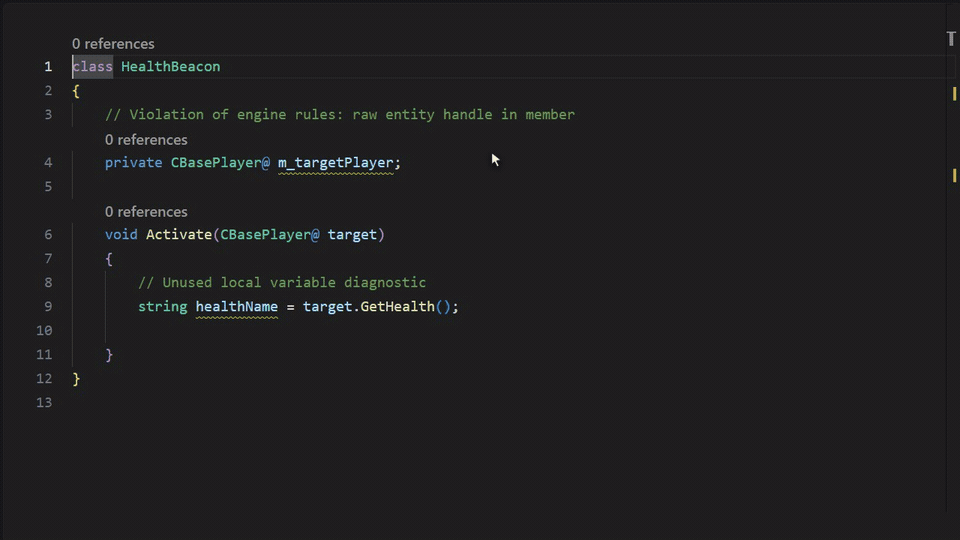

# AngelScript engine rules

[English](RULES.md) | [Español](RULES.es.md)



*A storage rule flags a handle in a class field.*

A rules file tells the extension which engine types or object handles to flag, where they can be used, and what message to show. It also lets you match the host's language options and tell the editor which functions the engine calls directly.


*A JSON file with engine options and a storage rule.*

## Where the file goes

Save `angelscript.rules.json` in the workspace root, or set `"angelscript.rulesFile": "${workspaceFolder}/config/game.angelscript.rules.json"` in `.vscode/settings.json` to select a file. The setting defaults to `""`.

The server loads one file. It tries the configured path, the exact root filename, files beside the active stub and then other known stubs, and finally any `*.angelscript.rules.json` in the root. Beside `game.as.predefined` it tries `game.angelscript.rules.json` first, then the first wildcard match in path order.

For a template, run **Configure Host Rules & Predefined API...** (`angelscript.configureHostEnvironment`) in the Command Palette and choose **Create Starter angelscript.rules.json in Workspace**.

## Complete examples

A handle is a reference to an object. Put `@` after the type to declare a handle.

### Forbid a handle in a class field

Open an empty folder in VS Code and save this file as `angelscript.rules.json` in its root.

```json
{
  "$schema": "https://raw.githubusercontent.com/Gaftherman/angelscript-lsp/main/schemas/angelscript.rules.schema.json",
  "storageRules": [
    {
      "id": "entity-member-handle",
      "types": ["CBaseEntity"],
      "handleOnly": true,
      "disallowInMembers": true,
      "suggestReplacement": "EHandle",
      "message": "Field '{}' stores an entity handle. Use '{}' instead."
    }
  ]
}
```

Save this as `main.as` in the same folder.

```angelscript
class CBaseEntity {}
class Tracker { CBaseEntity@ target; }
```

VS Code marks `target` with warning `W113`. “Field 'target' stores an entity handle. Use 'EHandle' instead.” Open the **Problems** panel (`Ctrl+Shift+M`) to see it listed.

If the warning doesn't appear, open **View → Output** and select **AngelScript C++ Language Server**.

### Forbid handles on a value type

```json
{
  "noHandleTypes": ["string"]
}
```

If your host declares `string` in a `.as.predefined` stub, `string@ label;` reports `E261` because the listed type cannot be used with `@`.

### Flag a call to an engine method

```json
{
  "callRules": [
    {
      "id": "avoid-recorder-reset",
      "receiverTypes": ["Recorder"],
      "methods": ["Reset"],
      "disallowMethod": true,
      "message": "Use Stop instead of Reset."
    }
  ]
}
```

`recorder.Reset()` reports `W121` with the configured warning when `Reset` resolves to a `Recorder` method.

## Field reference

Optional lists, maps and strings start empty unless a row gives a different default.

| Field | What it does | Example |
| --- | --- | --- |
| `$schema` | Enables JSON property suggestions and validation in VS Code. | Use the URL in the first example. |
| `name` | Gives the ruleset a descriptive name. | `"Game engine rules"` |
| `noHandleTypes` | Reports `E261` (`as-err-handle-on-no-handle-type`) for handles to listed types, including through typedefs. Merges with `angelscript.engine.noHandleTypes` and `--no-handle-type=<name>`. | `["string", "Game::Value"]` |
| `engineProperties` | Overrides the editor's engine options for the properties you supply. | `{"requireEnumScope": true}` |
| `storageRules` | Flags where matching types or handles are stored. | `[{"id": "member", "types": ["Entity"], "disallowInMembers": true}]` |
| `typeSuggestions` | Recommends a replacement for a type used in a variable declaration. | `[{"id": "prefer-string", "fromType": "string_t", "toType": "string"}]` |
| `callRules` | Checks calls and their arguments. | `[{"id": "no-reset", "methods": ["Reset"], "disallowMethod": true}]` |
| `schedulerRules` | Legacy alias used when the server reads no entries from `callRules`. | Same array as `callRules` |
| `unusedSymbolRules` | Configures unused-symbol warnings and exemptions for engine callbacks. | `{"ignoredGlobalFunctions": ["MapInit"]}` |

The [JSON schema](../schemas/angelscript.rules.schema.json) defines the file format. The [Sven Co-op rules file](../predefined/sven.angelscript.rules.json) is a complete example paired with a host stub.

### Engine properties

The table shows AngelLSP's defaults. In `engineProperties`, VS Code validates the types and allowed values of the seven camelCase keys defined in the schema. Other keys that AngelLSP accepts, such as `compilerWarnings` and the `asEP_*` aliases below, still work even if VS Code flags them.

| Field | What it does | Example |
| --- | --- | --- |
| `propertyAccessorMode` (`asEP_PROPERTY_ACCESSOR_MODE`) | Selects accessor mode `0`–`3`. Default `2` allows implicit `get_X` and `set_X` accessors. | `3` requires `property` on script accessors |
| `disallowGlobalVars` (`asEP_DISALLOW_GLOBAL_VARS`) | Forbids global variable declarations. Default `false`. | `true` |
| `requireEnumScope` (`asEP_REQUIRE_ENUM_SCOPE`) | Requires qualified enumerators. Default `false`. | `true` requires `State::Ready` |
| `boolConversionMode` (`asEP_BOOL_CONVERSION_MODE`) | Controls implicit use of class conversion operators to `bool`. Default `0`. | `1` allows `if (obj)` when the type has a matching conversion |
| `allowUnsafeReferences` (`asEP_ALLOW_UNSAFE_REFERENCES`) | Relaxes restrictions on reference parameters. Default `false`. | `true` allows `int&inout` |
| `allowMultilineStrings` (`asEP_ALLOW_MULTILINE_STRINGS`) | Allows raw newlines inside quoted strings. Default `false`. | `true` |
| `disableIntegerDivision` (`asEP_DISABLE_INTEGER_DIVISION`) | Makes division of integers yield a floating-point value. Default `false`. | `true` |
| `privatePropAsProtected` (`asEP_PRIVATE_PROP_AS_PROTECTED`) | Gives derived classes access to private members through the protected-access rule. Default `false`. | `true` |
| `useCharacterLiterals` (`asEP_USE_CHARACTER_LITERALS`) | Selects how single quotes are read. Default `0` treats them as strings. | `1` treats `'A'` as a character code |
| `disallowValueAssignForRef` (`asEP_DISALLOW_VALUE_ASSIGN_FOR_REF_TYPE`, `asEP_DISALLOW_VALUE_ASSIGN_FOR_REF`) | Requires handle assignment for reference types. Default `false`. | `true` |
| `alterSyntaxNamedArgs` (`asEP_ALTER_SYNTAX_NAMED_ARGS`) | Controls `name = value` in calls. Default `0` rejects it, `1` warns, and `2` accepts it. | `2` |
| `disallowEmptyListElements` (`asEP_DISALLOW_EMPTY_LIST_ELEMENTS`) | Rejects gaps in initializer lists. Default `false`. | `true` rejects `{1, , 3}` |
| `foreachSupport` (`asEP_FOREACH_SUPPORT`) | Enables `foreach` syntax. Default `true`. | `false` |
| `alwaysImplDefaultConstruct` (`asEP_ALWAYS_IMPL_DEFAULT_CONSTRUCT`) | Provides an implicit default constructor even when a class declares other constructors. Default `false`. | `true` |
| `allowUnicodeIdentifiers` (`asEP_ALLOW_UNICODE_IDENTIFIERS`) | Allows non-ASCII letters in names. Default `false`. | `true` |
| `ignoreDuplicateSharedIntf` (`asEP_IGNORE_DUPLICATE_SHARED_INTF`) | Allows identical shared interface declarations across files. Default `false`. | `true` |
| `compilerWarnings` (`asEP_COMPILER_WARNINGS`) | Selects warning mode. Default `1` reports warnings, `0` hides them, and `2` promotes them to errors. | `2` |
| `memberInitMode` (`asEP_MEMBER_INIT_MODE`) | Loads the host's member initialization mode into server configuration. Default `0`. | `1` |
| `heredocTrimMode` (`asEP_HEREDOC_TRIM_MODE`) | Loads the host's heredoc trimming mode into server configuration. Default `1`. | `0` |

### Storage, type suggestions and calls

The schema requires `id` in every rule entry and also `fromType` and `toType` for type suggestions. Severity values are `error`, `warning`, `info`, `information` and `hint`. The `W` codes below identify diagnostics even when you change their severity.

| Field | What it does | Example |
| --- | --- | --- |
| `id` | Identifies a rule. | `"entity-member-handle"` |
| `storageRules[].types`, `inheritsFrom`, `typeRegex` | Match by exact name, base type (including the base itself), or full regex match. Any matching selector qualifies. | `["Entity"]`, `"BaseEntity"`, `"CBase.*"` |
| `storageRules[].handleOnly` | Limits matching to handles. Default `false`. | `true` |
| `storageRules[].disallowInMembers`, `disallowInGlobals`, `disallowInArrays` | Flag fields, top-level globals or array elements respectively. Each defaults to `false`. | `"disallowInGlobals": true` |
| `storageRules[].suggestReplacement`, `message`, `severity` | Configure `W113`. A custom message can use `{}` for the variable name and then `{}` for the replacement. Default severity `warning`. | `"EHandle"`, `"Field '{}'. Use '{}'."`, `"error"` |
| `typeSuggestions[].fromType`, `toType` | Name the type to flag and the replacement to recommend. | `"string_t"`, `"string"` |
| `typeSuggestions[].appliesTo` | The schema lists `local`, `member`, `param`, `return` and `all` (default `["all"]`). The current checker reads variable declarations and ignores this filter. | `["local"]` |
| `typeSuggestions[].message`, `severity` | Configure `W160`. Custom text is shown verbatim. Default severity `hint`. | `"Use string."`, `"information"` |
| `callRules[].callee`, `receiverTypes` | Match receiver text or the declaring type of a resolved method. If both are empty, any receiver matches. | `"g_Scheduler"`, `["CScheduler"]` |
| `callRules[].methods`, `methodNames` | Name the methods to check. Both lists are combined. | `["SetTimeout", "SetInterval"]` |
| `callRules[].disallowArgInheritsFrom`, `disallowArgRegex`, `disallowArgHandleOnly` | Flag arguments matching a base type or regex (`W114`). The handle filter defaults to `true`. | `"CBaseEntity"`, `"CBase.*"`, `false` |
| `callRules[].argSuggestReplacement` | The server reads this field. To show a replacement in `W114`, put it in `message`. | `"EHandle"` |
| `callRules[].disallowParamInheritsFrom`, `disallowParamRegex`, `disallowParamHandleOnly`, `paramSuggestReplacement` | The server reads these callback parameter fields. The current checker leaves callback parameters unchecked. The handle filter defaults to `true`. | `"CBaseEntity"`, `"CBase.*"`, `false`, `"EHandle"` |
| `callRules[].disallowMethod`, `suggestReplacement` | Flag a matching call (`W121`) and suggest another API. `disallowMethod` defaults to `false`. | `true`, `"Stop"` |
| `callRules[].requireExplicitEnumConstruct` | Warns when an integer is passed in an enum parameter position of a resolved candidate (`W115`). Default `false`. | `true` |
| `callRules[].message`, `severity` | Configure `W114` and `W121`. A `W121` template can use `{}` for the method and then `{}` for its replacement. `W114` uses literal text. Default severity `warning`. | `"Call Stop instead."`, `"error"` |

### Unused symbols

These rules cover unused locals (`W103`), fields (`W116`), globals (`W117`), functions (`W118`), methods (`W119`) and classes (`W120`).

| Field | What it does | Example |
| --- | --- | --- |
| `enabled` | Defaults to `true` inside `unusedSymbolRules`. With `false` or no section, ordinary diagnostic settings control the member, global, function and class checks. | `false` |
| `checkLocals`, `checkMembers`, `checkGlobals`, `checkFunctions`, `checkClasses` | Enable the individual checks. Each defaults to `true` within the section. Explicit editor settings can override the member, global, function and class checks. | `"checkLocals": false` |
| `ignoreUnusedGlobalsWithCallInitializer`, `unusedGlobalExemptTypes` | Exempt globals initialized by a call or globals of listed types. The initializer flag defaults to `false`. | `true`, `["CClientCommand"]` |
| `ignoredGlobalFunctions`, `ignoredGlobalFunctionRegex` | Exempt host entry points by name or regex. | `["MapInit"]`, `"^On.*"` |
| `ignoredBaseClasses`, `lifecycleMethods` | Exempt classes derived from listed bases and lifecycle methods on those classes. An empty base list lets the method names apply to any class. | `["ScriptBaseEntity"]`, `["Spawn"]` |
| `baseClassLifecycleMethods` | Exempts methods by base class. | `{"ScriptBaseEntity": ["Precache"]}` |
| `baseClassDelegateProperties`, `baseClassProxyMap` | Link properties such as `BaseClass` and script base classes to native declarations in a stub. Map values can be one name or a list. | `["BaseClass"]`, `{"ScriptBaseEntity": ["CBaseEntity"]}` |
| `stringReflectionCallees` | Counts string arguments that name symbols as references. Entries require `callee` and `methods`. Use zero-based `argIndices`, or `argIndex` for one position. | `[{"callee": "g_CustomEntityFuncs", "methods": ["RegisterCustomEntity"], "argIndex": 0}]` |
| `engineCallbackSignatures` | Exempts global functions whose parameter types match a listed signature. | `[["CBaseEntity@", "float"]]` |

## Troubleshooting

- Check the **AngelScript C++ Language Server** output for the file path it loaded or a JSON parse error.
- Confirm the names in your rule match the declarations in the workspace or the active stub.
- For a storage rule, check that you set both a type selector and a storage location. For a call rule, include the method name.
